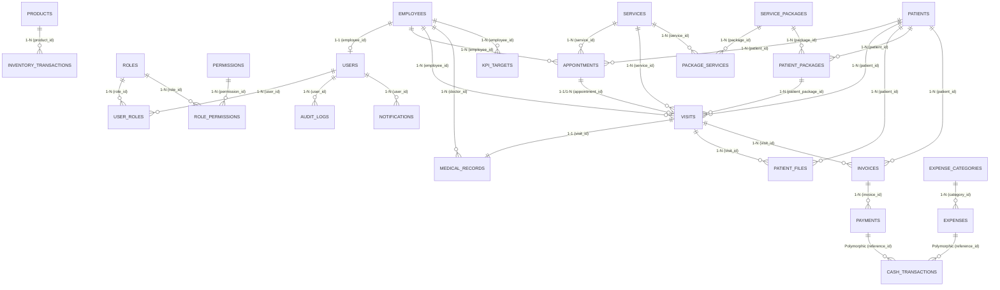

# TÀI LIỆU THIẾT KẾ CHI TIẾT CƠ SỞ DỮ LIỆU PHÒNG KHÁM (DATABASE SCHEMA SPECIFICATION)
## HỆ THỐNG QUẢN LÝ PHÒNG KHÁM CHUYÊN NGHIỆP (`DBQLPK`)
### BÁO CÁO THIẾT KẾ CSDL & ĐẶC TẢ KHÓA - RÀNG BUỘC TOÀN VẸN (UIT)

---

- **Hệ quản trị CSDL:** MySQL 8.0 / InnoDB Engine
- **Bộ mã ký tự (Collation):** `utf8mb4_unicode_ci` (Hỗ trợ tiếng Việt đầy đủ và ký tự Unicode)
- **Chuẩn hóa dữ liệu:** 3NF (Third Normal Form) – Triệt tiêu dư thừa, bảo đảm tính nhất quán và toàn vẹn tham chiếu.
- **Tổng số bảng:** 31 bảng dữ liệu phân chia theo 8 phân hệ chức năng.

---

## MỤC LỤC TỔNG QUAN

1. [SƠ ĐỒ THỰC THỂ MỐI QUAN HỆ (ERD - ENTITY RELATIONSHIP DIAGRAM)](#1-sơ-đồ-thực-thể-mối-quan-hệ-erd---entity-relationship-diagram)
2. [DANH MỤC CÁC PHÂN HỆ VÀ CÁC BẢNG TRONG HỆ THỐNG](#2-danh-mục-các-phân-hệ-và-các-bảng-trong-hệ-thống)
3. [CẤU TRÚC CHI TIẾT TỪNG BẢNG DỮ LIỆU (DATA DICTIONARY)](#3-cấu-trúc-chi-tiết-từng-bảng-dữ-liệu-data-dictionary)
4. [MA TRẬN MỐI QUAN HỆ GIỮA CÁC BẢNG (1-1, 1-N, N-N)](#4-ma-trận-mối-quan-hệ-giữa-các-bảng-1-1-1-n-n-n)
5. [THIẾT KẾ KHÓA VÀ CÁC RÀNG BUỘC DỮ LIỆU](#5-thiết-kế-khóa-và-các-ràng-buộc-dữ-liệu)
   - [5.1. Khóa chính (Primary Key)](#51-khóa-chính-primary-key)
   - [5.2. Khóa ngoại (Foreign Key)](#52-khóa-ngoại-foreign-key)
   - [5.3. Ràng buộc dữ liệu (NOT NULL, UNIQUE, CHECK, DEFAULT)](#53-ràng-buộc-dữ-liệu-not-null-unique-check-default)
6. [HƯỚNG DẪN TRẢ LỜI VẤN ĐÁP CSDL TRƯỚC GIẢNG VIÊN](#6-hướng-dẫn-trả-lời-vấn-đáp-csdl-trước-giảng-viên)

---

## 1. SƠ ĐỒ THỰC THỂ MỐI QUAN HỆ (ERD - ENTITY RELATIONSHIP DIAGRAM)



---

## 2. DANH MỤC CÁC PHÂN HỆ VÀ CÁC BẢNG TRONG HỆ THỐNG

Hệ thống quản lý 31 bảng dữ liệu, gom thành 8 nhóm phân hệ logic:

| STT | Nhóm Phân Hệ | Danh sách bảng dữ liệu | Mục đích nghiệp vụ |
|:---:|:---|:---|:---|
| 1 | **Xác thực & Phân quyền (RBAC)** | `users`, `employees`, `roles`, `permissions`, `user_roles`, `role_permissions` | Quản lý tài khoản, nhân sự, phân bổ 8 vai trò và ma trận quyền hạn granular. |
| 2 | **Khách hàng & Bệnh nhân** | `patients`, `patient_files` | Quản lý hồ sơ bệnh nhân, thông tin định danh y tế và tệp đính kèm phim chụp X-quang/PDF. |
| 3 | **Danh mục Dịch vụ & Gói khám** | `services`, `service_packages`, `package_services`, `patient_packages` | Bảng giá dịch vụ lâm sàng, cận lâm sàng, gói dịch vụ nhiều buổi và theo dõi số buổi còn lại. |
| 4 | **Lịch hẹn & Khám bệnh (EMR)** | `appointments`, `visits`, `medical_records` | Đặt lịch khám, tiếp đón phòng chờ, ca khám lâm sàng và bệnh án điện tử (chẩn đoán, đơn thuốc). |
| 5 | **Tài chính, Viện phí & Sổ quỹ** | `invoices`, `payments`, `cash_transactions`, `expenses`, `expense_categories` | Lập hóa đơn viện phí, thanh toán nhiều đợt, công nợ, quản lý sổ quỹ thu-chi tiền mặt và ngân hàng. |
| 6 | **Kho Dược & Vật tư y tế** | `products`, `inventory_transactions` | Danh mục thuốc, vật tư y tế tiêu hao, lịch sử giao dịch nhập - xuất - điều chỉnh kho. |
| 7 | **Đánh giá Nhân sự & Hiệu suất** | `kpi_targets` | Giao chỉ tiêu doanh thu, chỉ tiêu ca khám cho bác sĩ và đánh giá tỷ lệ hoàn thành. |
| 8 | **Quản trị, Kiểm toán & Hệ thống** | `audit_logs`, `db_demo_audit_logs`, `system_settings`, `approval_requests`, `notifications`, `alert_rules`, `import_batches`, `import_errors` | Nhật ký kiểm toán bất biến (audit trail), cấu hình tham số, phê duyệt đề xuất chi tiêu, thông báo nội bộ. |

---

## 3. CẤU TRÚC CHI TIẾT TỪNG BẢNG DỮ LIỆU (DATA DICTIONARY)

---

### PHÂN HỆ 1: XÁC THỰC, NHÂN SỰ & PHÂN QUYỀN (RBAC)

#### Bảng 1: `employees` (Hồ sơ Nhân sự & Y Bác sĩ)
- **Ý nghĩa:** Quản lý toàn bộ nhân sự làm việc tại phòng khám (Bác sĩ, Điều dưỡng, Tiếp tân, Thu ngân, Kế toán, Quản lý).
- **Cấu trúc cột:**

| Tên cột | Kiểu dữ liệu | Khóa | Nullable | Mặc định | Ý nghĩa & Mô tả |
|---|---|:---:|:---:|:---:|---|
| `id` | `BIGINT UNSIGNED` | **PK** | NO | Auto Increment | Định danh duy nhất nhân viên |
| `employee_code` | `VARCHAR(50)` | **UK** | NO | None | Mã nhân viên duy nhất (Ví dụ: `NV000001`, `BS000002`) |
| `full_name` | `VARCHAR(150)` | | NO | None | Họ và tên nhân viên |
| `phone` | `VARCHAR(20)` | | NO | None | Số điện thoại liên hệ |
| `email` | `VARCHAR(191)` | **UK** | YES | NULL | Email công vụ |
| `date_of_birth` | `DATE` | | YES | NULL | Ngày sinh |
| `gender` | `VARCHAR(20)` | | YES | NULL | Giới tính (`MALE`, `FEMALE`, `OTHER`) |
| `position` | `VARCHAR(100)` | | YES | NULL | Chức vụ (Bác sĩ chuyên khoa, Điều dưỡng trưởng, ...) |
| `department` | `VARCHAR(100)` | | YES | NULL | Phòng ban / Khoa (Khoa Nội, Khoa Nhi, Lễ tân, ...) |
| `hire_date` | `DATE` | | YES | NULL | Ngày vào làm |
| `status` | `VARCHAR(30)` | | NO | `'ACTIVE'` | Trạng thái (`ACTIVE`, `INACTIVE`, `ON_LEAVE`) |
| `notes` | `TEXT` | | YES | NULL | Ghi chú thêm |
| `created_at` | `TIMESTAMP` | | YES | NULL | Thời điểm tạo |
| `updated_at` | `TIMESTAMP` | | YES | NULL | Thời điểm cập nhật cuối |

---

#### Bảng 2: `users` (Tài khoản người dùng đăng nhập hệ thống)
- **Ý nghĩa:** Quản lý thông tin đăng nhập, mật khẩu băm, liên kết 1-1 với hồ sơ nhân sự `employees`.
- **Cấu trúc cột:**

| Tên cột | Kiểu dữ liệu | Khóa | Nullable | Mặc định | Ý nghĩa & Mô tả |
|---|---|:---:|:---:|:---:|---|
| `id` | `BIGINT UNSIGNED` | **PK** | NO | Auto Increment | Mã tài khoản |
| `employee_id` | `BIGINT UNSIGNED` | **FK** | YES | NULL | Tham chiếu tới `employees.id` (ON DELETE SET NULL) |
| `username` | `VARCHAR(100)` | **UK** | NO | None | Tên đăng nhập duy nhất (admin, doctor, cashier, ...) |
| `email` | `VARCHAR(191)` | | YES | NULL | Email tài khoản |
| `password_hash` | `VARCHAR(255)` | | NO | None | Mật khẩu đã băm 1 chiều (Bcrypt cost 12) |
| `status` | `VARCHAR(30)` | | NO | `'ACTIVE'` | Trạng thái (`ACTIVE`, `LOCKED`, `INACTIVE`) |
| `last_login_at` | `TIMESTAMP` | | YES | NULL | Thời điểm đăng nhập gần nhất |
| `created_at` | `TIMESTAMP` | | YES | NULL | Thời điểm tạo |
| `updated_at` | `TIMESTAMP` | | YES | NULL | Thời điểm sửa |

---

#### Bảng 3: `roles` (Danh mục Vai trò người dùng)
- **Ý nghĩa:** Định nghĩa 8 vai trò chuẩn trong phòng khám: `ADMIN`, `MANAGER`, `DOCTOR`, `NURSE`, `RECEPTIONIST`, `CASHIER`, `ACCOUNTANT`, `EMPLOYEE`.
- **Cấu trúc cột:**

| Tên cột | Kiểu dữ liệu | Khóa | Nullable | Mặc định | Ý nghĩa & Mô tả |
|---|---|:---:|:---:|:---:|---|
| `id` | `BIGINT UNSIGNED` | **PK** | NO | Auto Increment | Mã vai trò |
| `name` | `VARCHAR(50)` | **UK** | NO | None | Tên mã vai trò viết hoa không dấu |
| `description` | `VARCHAR(255)` | | YES | NULL | Mô tả quyền hạn của vai trò |
| `created_at` | `TIMESTAMP` | | YES | NULL | Thời điểm tạo |
| `updated_at` | `TIMESTAMP` | | YES | NULL | Thời điểm sửa |

---

#### Bảng 4: `permissions` (Danh mục Quyền hạn chi tiết)
- **Ý nghĩa:** Định nghĩa các quyền nguyên tử (`users.view`, `appointments.create`, `medical_records.update`, ...).
- **Cấu trúc cột:**

| Tên cột | Kiểu dữ liệu | Khóa | Nullable | Mặc định | Ý nghĩa & Mô tả |
|---|---|:---:|:---:|:---:|---|
| `id` | `BIGINT UNSIGNED` | **PK** | NO | Auto Increment | Mã quyền |
| `module` | `VARCHAR(50)` | | NO | None | Tên phân hệ (auth, patients, invoices, ...) |
| `action` | `VARCHAR(50)` | | NO | None | Hành động (view, create, update, delete, approve, ...) |
| `permission_key` | `VARCHAR(100)` | **UK** | NO | None | Khóa quyền dạng chuỗi duy nhất (`module.action`) |
| `description` | `VARCHAR(255)` | | YES | NULL | Mô tả chi tiết quyền |
| `created_at` | `TIMESTAMP` | | YES | NULL | Thời điểm tạo |
| `updated_at` | `TIMESTAMP` | | YES | NULL | Thời điểm sửa |

---

#### Bảng 5: `user_roles` (Bảng trung gian N-N giữa User và Role)
- **Cấu trúc cột:**
  - `id`: `BIGINT UNSIGNED AUTO_INCREMENT PK` (hoặc Composite PK `user_id, role_id`).
  - `user_id`: `BIGINT UNSIGNED FK -> users.id` (ON DELETE CASCADE).
  - `role_id`: `BIGINT UNSIGNED FK -> roles.id` (ON DELETE CASCADE).
  - `created_at`: `TIMESTAMP`.

#### Bảng 6: `role_permissions` (Bảng trung gian N-N giữa Role và Permission)
- **Cấu trúc cột:**
  - `id`: `BIGINT UNSIGNED AUTO_INCREMENT PK` (hoặc Composite PK `role_id, permission_id`).
  - `role_id`: `BIGINT UNSIGNED FK -> roles.id` (ON DELETE CASCADE).
  - `permission_id`: `BIGINT UNSIGNED FK -> permissions.id` (ON DELETE CASCADE).
  - `created_at`: `TIMESTAMP`.

---

### PHÂN HỆ 2: BỆNH NHÂN & HỒ SƠ Y TẾ ĐÍNH KÈM

#### Bảng 7: `patients` (Hồ sơ Bệnh nhân)
- **Ý nghĩa:** Quản lý thông tin định danh, nhân khẩu học, tiền sử tiếp đón và công nợ của bệnh nhân.
- **Cấu trúc cột:**

| Tên cột | Kiểu dữ liệu | Khóa | Nullable | Mặc định | Ý nghĩa & Mô tả |
|---|---|:---:|:---:|:---:|---|
| `id` | `BIGINT UNSIGNED` | **PK** | NO | Auto Increment | Mã định danh nội bộ bệnh nhân |
| `patient_code` | `VARCHAR(50)` | **UK** | NO | None | Mã bệnh nhân duy nhất (Ví dụ: `BN000001`) |
| `full_name` | `VARCHAR(150)` | | NO | None | Họ và tên bệnh nhân |
| `date_of_birth` | `DATE` | | YES | NULL | Ngày tháng năm sinh |
| `gender` | `VARCHAR(20)` | | NO | None | Giới tính (`MALE`, `FEMALE`, `OTHER`) |
| `phone` | `VARCHAR(20)` | | NO | None | Số điện thoại (Áp dụng Data Masking khi xem) |
| `email` | `VARCHAR(191)` | | YES | NULL | Địa chỉ thư điện tử |
| `address` | `TEXT` | | YES | NULL | Địa chỉ cư trú |
| `emergency_contact_name` | `VARCHAR(150)` | | YES | NULL | Người liên hệ khẩn cấp |
| `emergency_contact_phone` | `VARCHAR(20)` | | YES | NULL | SĐT người liên hệ khẩn cấp |
| `first_visit_date` | `DATE` | | YES | NULL | Ngày đầu tiên đến phòng khám |
| `last_visit_date` | `DATE` | | YES | NULL | Ngày khám gần nhất (Được Trigger cập nhật) |
| `status` | `VARCHAR(30)` | | NO | `'ACTIVE'` | Trạng thái (`ACTIVE`, `INACTIVE`, `ARCHIVED`) |
| `notes` | `TEXT` | | YES | NULL | Ghi chú đặc biệt (Dị ứng thuốc, tiền sử bệnh) |
| `created_at` | `TIMESTAMP` | | YES | NULL | Thời điểm tạo hồ sơ |
| `updated_at` | `TIMESTAMP` | | YES | NULL | Thời điểm sửa |

---

#### Bảng 8: `patient_files` (Tệp đính kèm y tế của bệnh nhân)
- **Ý nghĩa:** Lưu trữ đường dẫn tệp X-quang, phim CT, kết quả xét nghiệm PDF đính kèm ca khám.
- **Cấu trúc cột:**

| Tên cột | Kiểu dữ liệu | Khóa | Nullable | Mặc định | Ý nghĩa & Mô tả |
|---|---|:---:|:---:|:---:|---|
| `id` | `BIGINT UNSIGNED` | **PK** | NO | Auto Increment | Mã tệp |
| `patient_id` | `BIGINT UNSIGNED` | **FK** | NO | None | Tham chiếu `patients.id` (ON DELETE CASCADE) |
| `visit_id` | `BIGINT UNSIGNED` | **FK** | YES | NULL | Tham chiếu `visits.id` (ON DELETE SET NULL) |
| `file_name` | `VARCHAR(255)` | | NO | None | Tên gốc của tệp tải lên |
| `storage_path` | `VARCHAR(500)` | | NO | None | Đường dẫn lưu trữ nội bộ trên máy chủ |
| `mime_type` | `VARCHAR(100)` | | NO | None | Định dạng tệp (`image/jpeg`, `application/pdf`, ...) |
| `file_size` | `BIGINT` | | NO | None | Kích thước tệp tính theo Bytes |
| `uploaded_by` | `BIGINT UNSIGNED` | **FK** | YES | NULL | Tài khoản tải lên (Tham chiếu `users.id`) |
| `created_at` | `TIMESTAMP` | | YES | NULL | Thời điểm tải lên |

---

### PHÂN HỆ 3: DỊCH VỤ KHÁM & GÓI LIỆU TRÌNH

#### Bảng 9: `services` (Danh mục Dịch vụ khám chữa bệnh)
- **Cấu trúc:** `id (PK)`, `service_code (UK)`, `name`, `description`, `price (DECIMAL 15,2)`, `duration_minutes (INT DEFAULT 30)`, `status ('ACTIVE'/'INACTIVE')`, `timestamps`.

#### Bảng 10: `service_packages` (Danh mục Gói dịch vụ định lượng)
- **Cấu trúc:** `id (PK)`, `package_code (UK)`, `name`, `description`, `price (DECIMAL 15,2)`, `total_sessions (INT)`, `validity_days (INT)`, `status`, `timestamps`.

#### Bảng 11: `package_services` (Bảng chi tiết dịch vụ trong gói - N-N)
- **Cấu trúc:** `package_id (FK -> service_packages.id CASCADE)`, `service_id (FK -> services.id CASCADE)`, `quantity (INT DEFAULT 1)`, `created_at`.

#### Bảng 12: `patient_packages` (Gói dịch vụ bệnh nhân đã mua)
- **Cấu trúc:** `id (PK)`, `patient_id (FK -> patients.id CASCADE)`, `package_id (FK -> service_packages.id CASCADE)`, `purchase_date (DATE)`, `expiry_date (DATE)`, `total_sessions (INT)`, `used_sessions (INT DEFAULT 0)`, `remaining_sessions (INT)`, `price (DECIMAL 15,2)`, `status ('ACTIVE'/'COMPLETED'/'EXPIRED'/'CANCELLED')`, `timestamps`.

---

### PHÂN HỆ 4: LỊCH HẸN, CA KHÁM & BỆNH ÁN ĐIỆN TỬ (EMR)

#### Bảng 13: `appointments` (Lịch hẹn khám)
- **Ý nghĩa:** Quản lý việc đặt lịch trước giữa bệnh nhân và bác sĩ theo khung giờ.
- **Cấu trúc cột:**

| Tên cột | Kiểu dữ liệu | Khóa | Nullable | Mặc định | Ý nghĩa & Mô tả |
|---|---|:---:|:---:|:---:|---|
| `id` | `BIGINT UNSIGNED` | **PK** | NO | Auto Increment | Mã lịch hẹn |
| `appointment_code` | `VARCHAR(50)` | **UK** | NO | None | Mã lịch hẹn duy nhất (Ví dụ: `LH261108001`) |
| `patient_id` | `BIGINT UNSIGNED` | **FK** | NO | None | Tham chiếu `patients.id` |
| `employee_id` | `BIGINT UNSIGNED` | **FK** | NO | None | Bác sĩ phụ trách (`employees.id`) |
| `service_id` | `BIGINT UNSIGNED` | **FK** | YES | NULL | Dịch vụ đăng ký (`services.id`) |
| `appointment_date` | `DATE` | | NO | None | Ngày khám hẹn trước |
| `start_time` | `TIME` | | NO | None | Giờ bắt đầu khám |
| `end_time` | `TIME` | | NO | None | Giờ kết thúc dự kiến |
| `status` | `VARCHAR(30)` | | NO | `'PENDING'` | Trạng thái (`PENDING`, `CONFIRMED`, `COMPLETED`, `CANCELLED`, `NO_SHOW`) |
| `notes` | `TEXT` | | YES | NULL | Lý do khám hoặc lý do hủy lịch |
| `created_by` | `BIGINT UNSIGNED` | **FK** | YES | NULL | Người tạo lịch (`users.id`) |
| `created_at` | `TIMESTAMP` | | YES | NULL | Thời điểm tạo |
| `updated_at` | `TIMESTAMP` | | YES | NULL | Thời điểm sửa |

---

#### Bảng 14: `visits` (Lượt khám bệnh tại phòng khám)
- **Ý nghĩa:** Bảng trung tâm điều phối toàn bộ ca khám bệnh thực tế (từ khi vào phòng chờ đến khi khám xong và thanh toán).
- **Cấu trúc cột:**

| Tên cột | Kiểu dữ liệu | Khóa | Nullable | Mặc định | Ý nghĩa & Mô tả |
|---|---|:---:|:---:|:---:|---|
| `id` | `BIGINT UNSIGNED` | **PK** | NO | Auto Increment | Mã lượt khám |
| `visit_code` | `VARCHAR(50)` | **UK** | NO | None | Mã lượt khám duy nhất (Ví dụ: `VK2611080001`) |
| `patient_id` | `BIGINT UNSIGNED` | **FK** | NO | None | Tham chiếu `patients.id` |
| `employee_id` | `BIGINT UNSIGNED` | **FK** | NO | None | Bác sĩ khám (`employees.id`) |
| `service_id` | `BIGINT UNSIGNED` | **FK** | YES | NULL | Dịch vụ thực hiện (`services.id`) |
| `patient_package_id` | `BIGINT UNSIGNED` | **FK** | YES | NULL | Tham chiếu gói nếu trừ buổi (`patient_packages.id`) |
| `appointment_id` | `BIGINT UNSIGNED` | **FK** | YES | NULL | Lịch hẹn gốc nếu tiếp đón từ hẹn trước |
| `visit_date` | `DATETIME` | | NO | None | Ngày giờ tiếp đón vào khám |
| `quantity` | `INT` | | NO | `1` | Số lượng dịch vụ |
| `unit_price` | `DECIMAL(15,2)` | | NO | `0.00` | Đơn giá khám |
| `discount_amount` | `DECIMAL(15,2)` | | NO | `0.00` | Tiền giảm giá |
| `total_amount` | `DECIMAL(15,2)` | | NO | `0.00` | Tổng viện phí phải thu |
| `payment_status` | `VARCHAR(30)` | | NO | `'UNPAID'` | Tình trạng viện phí (`UNPAID`, `PARTIAL`, `PAID`, `PACKAGED`) |
| `status` | `VARCHAR(30)` | | NO | `'SCHEDULED'` | Tiến độ khám (`SCHEDULED`, `WAITING`, `IN_PROGRESS`, `COMPLETED`, `CANCELLED`) |
| `notes` | `TEXT` | | YES | NULL | Ghi chú của lễ tân / điều dưỡng |
| `created_by` | `BIGINT UNSIGNED` | **FK** | YES | NULL | Người tiếp đón (`users.id`) |
| `created_at` | `TIMESTAMP` | | YES | NULL | Thời điểm tạo |
| `updated_at` | `TIMESTAMP` | | YES | NULL | Thời điểm sửa |

---

#### Bảng 15: `medical_records` (Hồ sơ bệnh án điện tử EMR)
- **Ý nghĩa:** Chứa chẩn đoán chuyên môn, tiền sử bệnh, chỉ định cận lâm sàng và phác đồ điều trị/đơn thuốc của bác sĩ. Quan hệ 1–1 với `visits`.
- **Cấu trúc cột:**

| Tên cột | Kiểu dữ liệu | Khóa | Nullable | Mặc định | Ý nghĩa & Mô tả |
|---|---|:---:|:---:|:---:|---|
| `id` | `BIGINT UNSIGNED` | **PK** | NO | Auto Increment | Mã bệnh án |
| `visit_id` | `BIGINT UNSIGNED` | **FK, UK** | NO | None | Tham chiếu `visits.id` (1 ca khám có đúng 1 bệnh án) |
| `doctor_id` | `BIGINT UNSIGNED` | **FK** | NO | None | Bác sĩ lập bệnh án (`employees.id`) |
| `medical_history` | `TEXT` | | YES | NULL | Tiền sử bệnh lý của bệnh nhân |
| `diagnosis` | `TEXT` | | NO | None | Chẩn đoán xác định bệnh (Kèm mã ICD-10) |
| `indication` | `TEXT` | | YES | NULL | Chỉ định cận lâm sàng, xét nghiệm |
| `result` | `TEXT` | | YES | NULL | Kết quả xét nghiệm, kết luận cận lâm sàng |
| `treatment` | `TEXT` | | YES | NULL | Phác đồ điều trị, danh mục đơn thuốc và liều dùng |
| `follow_up_date` | `DATE` | | YES | NULL | Ngày hẹn tái khám |
| `created_at` | `TIMESTAMP` | | YES | NULL | Thời điểm lưu bệnh án |
| `updated_at` | `TIMESTAMP` | | YES | NULL | Thời điểm cập nhật cuối |

---

### PHÂN HỆ 5: HÓA ĐƠN, THANH TOÁN & SỔ QUỸ TIỀN MẶT / NGÂN HÀNG

#### Bảng 16: `invoices` (Hóa đơn viện phí)
- **Ý nghĩa:** Quản lý chứng từ công nợ và tổng tiền viện phí phát sinh của ca khám.
- **Cấu trúc cột:**
  - `id`: `BIGINT UNSIGNED PK AUTO_INCREMENT`.
  - `invoice_code`: `VARCHAR(50) UK NOT NULL` (Ví dụ: `HD2611080001`).
  - `patient_id`: `BIGINT UNSIGNED FK -> patients.id NOT NULL`.
  - `visit_id`: `BIGINT UNSIGNED FK -> visits.id NULLABLE`.
  - `patient_package_id`: `BIGINT UNSIGNED FK -> patient_packages.id NULLABLE`.
  - `subtotal_amount`: `DECIMAL(15,2) NOT NULL DEFAULT 0.00`.
  - `discount_amount`: `DECIMAL(15,2) NOT NULL DEFAULT 0.00`.
  - `total_amount`: `DECIMAL(15,2) NOT NULL DEFAULT 0.00` (Tiền thực phải thu = Subtotal - Discount).
  - `paid_amount`: `DECIMAL(15,2) NOT NULL DEFAULT 0.00` (Tiền bệnh nhân đã nộp).
  - `remaining_amount`: `DECIMAL(15,2) NOT NULL DEFAULT 0.00` (Công nợ còn lại = Total - Paid).
  - `status`: `VARCHAR(30) NOT NULL` (`UNPAID`, `PARTIAL`, `PAID`, `CANCELLED`).
  - `issued_at`: `DATETIME NOT NULL`.
  - `created_by`: `BIGINT UNSIGNED FK -> users.id NULLABLE`.
  - `created_at`, `updated_at`.

#### Bảng 17: `payments` (Lịch sử thanh toán thu tiền viện phí)
- **Ý nghĩa:** Quản lý các đợt nộp tiền (thu đợt 1 tạm ứng, thu đợt 2 dứt điểm) của từng hóa đơn.
- **Cấu trúc cột:**
  - `id`: `BIGINT UNSIGNED PK AUTO_INCREMENT`.
  - `payment_code`: `VARCHAR(50) UK NOT NULL` (Ví dụ: `PAY261108001`).
  - `invoice_id`: `BIGINT UNSIGNED FK -> invoices.id NOT NULL (ON DELETE CASCADE)`.
  - `amount`: `DECIMAL(15,2) NOT NULL` (Số tiền nộp đợt này > 0).
  - `payment_method`: `VARCHAR(30) NOT NULL` (`CASH`, `BANK_TRANSFER`, `CARD`).
  - `reference_code`: `VARCHAR(100) NULLABLE` (Mã tham chiếu ngân hàng / mã giao dịch POS).
  - `payment_date`: `DATETIME NOT NULL`.
  - `received_by`: `BIGINT UNSIGNED FK -> users.id NULLABLE` (Thu ngân thu tiền).
  - `notes`: `TEXT NULLABLE`.
  - `created_at`, `updated_at`.

#### Bảng 18: `cash_transactions` (Sổ quỹ tiền mặt và tài khoản ngân hàng)
- **Ý nghĩa:** Quản lý toàn bộ biến động dòng tiền vào (IN - Thu viện phí) và dòng tiền ra (OUT - Chi phí hoạt động). Dùng quan hệ đa hình Polymorphic.
- **Cấu trúc cột:**
  - `id`: `BIGINT UNSIGNED PK AUTO_INCREMENT`.
  - `transaction_code`: `VARCHAR(50) UK NOT NULL` (Ví dụ: `PT261108001`, `PC261108001`).
  - `transaction_type`: `VARCHAR(30) NOT NULL` (`IN` = Thu tiền, `OUT` = Chi tiền).
  - `reference_type`: `VARCHAR(50) NOT NULL` (Loại đối tượng gốc: `'Payment'`, `'Expense'`).
  - `reference_id`: `BIGINT NOT NULL` (ID của Payment hoặc ID của Expense).
  - `amount`: `DECIMAL(15,2) NOT NULL` (> 0).
  - `payment_method`: `VARCHAR(30) NOT NULL` (`CASH`, `BANK_TRANSFER`, `CARD`).
  - `transaction_date`: `DATETIME NOT NULL`.
  - `description`: `TEXT NULLABLE`.
  - `created_by`: `BIGINT UNSIGNED FK -> users.id NULLABLE`.
  - `created_at`: `DATETIME NOT NULL`.

#### Bảng 19: `expense_categories` (Danh mục khoản mục chi tiêu)
- **Cấu trúc:** `id (PK)`, `name (UK)`, `description`, `status ('ACTIVE'/'INACTIVE')`, `timestamps`.

#### Bảng 20: `expenses` (Phiếu chi tiêu phòng khám)
- **Cấu trúc:** `id (PK)`, `expense_code (UK)`, `category_id (FK -> expense_categories.id)`, `amount (DECIMAL 15,2)`, `payment_method ('CASH'/'BANK_TRANSFER')`, `expense_date`, `description`, `approval_status ('PENDING'/'APPROVED'/'REJECTED')`, `created_by (FK -> users.id)`, `approved_by (FK -> users.id)`, `approved_at`, `timestamps`.

---

### PHÂN HỆ 6: KHO DƯỢC & VẬT TƯ TIÊU HAO

#### Bảng 21: `products` (Danh mục Thuốc & Vật tư y tế)
- **Ý nghĩa:** Quản lý tên biệt dược, quy cách đóng gói, đơn vị tính và định mức an toàn tối thiểu.
- **Cấu trúc cột:**

| Tên cột | Kiểu dữ liệu | Khóa | Nullable | Mặc định | Ý nghĩa & Mô tả |
|---|---|:---:|:---:|:---:|---|
| `id` | `BIGINT UNSIGNED` | **PK** | NO | Auto Increment | Mã thuốc |
| `product_code` | `VARCHAR(50)` | **UK** | NO | None | Mã thuốc duy nhất (Ví dụ: `THUOC-AUG1000`) |
| `name` | `VARCHAR(200)` | | NO | None | Tên thuốc / hoạt chất / vật tư tiêu hao |
| `unit` | `VARCHAR(50)` | | NO | None | Đơn vị tính (`Viên`, `Hộp`, `Lọ`, `Ống`, `Gói`, ...) |
| `cost_price` | `DECIMAL(15,2)` | | NO | `0.00` | Giá vốn nhập hàng |
| `selling_price`| `DECIMAL(15,2)` | | NO | `0.00` | Đơn giá bán lẻ theo đơn |
| `minimum_stock`| `DECIMAL(15,3)` | | NO | `0.000` | Định mức tồn kho tối thiểu cảnh báo hết hàng |
| `status` | `VARCHAR(30)` | | NO | `'ACTIVE'` | Trạng thái (`ACTIVE`, `INACTIVE`) |
| `created_at` | `TIMESTAMP` | | YES | NULL | Thời điểm tạo |
| `updated_at` | `TIMESTAMP` | | YES | NULL | Thời điểm sửa |

---

#### Bảng 22: `inventory_transactions` (Lịch sử biến động xuất nhập tồn kho)
- **Ý nghĩa:** Lưu trữ mọi phiếu Nhập kho (`IN`), Xuất kho theo đơn thuốc (`OUT`), Kiểm kê cân bằng (`ADJUST`). Tồn kho thời gian thực được tính toán động từ tổng đại số của bảng này.
- **Cấu trúc cột:**

| Tên cột | Kiểu dữ liệu | Khóa | Nullable | Mặc định | Ý nghĩa & Mô tả |
|---|---|:---:|:---:|:---:|---|
| `id` | `BIGINT UNSIGNED` | **PK** | NO | Auto Increment | Mã giao dịch kho |
| `product_id` | `BIGINT UNSIGNED` | **FK** | NO | None | Thuốc phát sinh biến động (`products.id`) |
| `transaction_type`| `VARCHAR(30)` | | NO | None | Loại giao dịch: `IN` (+), `OUT` (-), `ADJUST` (±) |
| `quantity` | `DECIMAL(15,3)` | | NO | None | Số lượng biến động (> 0) |
| `reference_type` | `VARCHAR(50)` | | YES | NULL | Nguồn gốc xuất nhập (`'Prescription'`, `'GoodsReceipt'`, `'Audit'`) |
| `reference_id` | `BIGINT` | | YES | NULL | ID tham chiếu (Ví dụ: ID của ca khám `visit_id`) |
| `transaction_date`| `DATETIME` | | NO | None | Thời điểm phát sinh giao dịch |
| `created_by` | `BIGINT UNSIGNED` | **FK** | YES | NULL | Thủ kho / Dược sĩ lập phiếu (`users.id`) |
| `created_at` | `DATETIME` | | NO | None | Thời điểm ghi hệ thống |

---

### PHÂN HỆ 7: CHỈ TIÊU & HIỆU SUẤT KPI BÁC SĨ

#### Bảng 23: `kpi_targets` (Kế hoạch chỉ tiêu hiệu suất nhân viên)
- **Ý nghĩa:** Giao chỉ tiêu doanh thu thực thu và số lượt khám hoàn tất cho từng bác sĩ theo từng kỳ tháng/quý.
- **Cấu trúc cột:**
  - `id`: `BIGINT UNSIGNED PK AUTO_INCREMENT`.
  - `employee_id`: `BIGINT UNSIGNED FK -> employees.id NOT NULL`.
  - `period_start`: `DATE NOT NULL` (Ngày bắt đầu kỳ đánh giá).
  - `period_end`: `DATE NOT NULL` (Ngày kết thúc kỳ đánh giá).
  - `target_revenue`: `DECIMAL(15,2) NOT NULL DEFAULT 0.00` (Mục tiêu doanh thu giao khoán).
  - `target_visits`: `INT NOT NULL DEFAULT 0` (Mục tiêu số ca khám giao khoán).
  - `created_by`: `BIGINT UNSIGNED FK -> users.id NULLABLE` (Ban Quản lý giao chỉ tiêu).
  - `created_at`, `updated_at`.

---

### PHÂN HỆ 8: KIỂM TOÁN, HỆ THỐNG & NHẬT KÝ DEMO

#### Bảng 24: `audit_logs` (Nhật ký kiểm toán toàn hệ thống - Bất biến)
- **Ý nghĩa:** Lưu vết toàn bộ thao tác Thêm, Sửa, Xóa dữ liệu của người dùng. Áp dụng cơ chế **Append-only (Chỉ thêm, cấm sửa, cấm xóa)**.
- **Cấu trúc:** `id (PK)`, `user_id (FK -> users.id NULLABLE)`, `module`, `action`, `table_name`, `record_id`, `old_values (JSON NULLABLE)`, `new_values (JSON NULLABLE)`, `ip_address`, `user_agent`, `created_at`.

#### Bảng 25: `db_demo_audit_logs` (Nhật ký lưu vết chạy Demo Quản lý Thông tin CSDL)
- **Ý nghĩa:** Chuyên phục vụ buổi báo cáo và chấm điểm đồ án: ghi nhận thời gian chạy ($ms$), mã câu lệnh SQL, bảng đích, JSON dữ liệu Before và After khi thực thi 15 đối tượng SQL.
- **Cấu trúc:** `id (PK)`, `executed_at (TIMESTAMP)`, `sql_object_name (VARCHAR 100)`, `sql_object_type (VARCHAR 30)`, `target_table (VARCHAR 100)`, `action_type (VARCHAR 50)`, `before_data (JSON NULLABLE)`, `after_data (JSON NULLABLE)`, `status (VARCHAR 30)`, `execution_message (TEXT NULLABLE)`, `executed_by (FK -> users.id NULLABLE)`, `duration_ms (INT DEFAULT 0)`, `timestamps`.

#### Bảng 26: `system_settings` (Cấu hình tham số hệ thống)
- **Cấu trúc:** `id (PK)`, `setting_key (VARCHAR 100 UK)`, `setting_value (TEXT)`, `description`, `updated_by (FK -> users.id)`, `timestamps`.

#### Bảng 27: `approval_requests` (Phiếu đề xuất chờ phê duyệt)
- **Cấu trúc:** `id (PK)`, `request_type`, `reference_type`, `reference_id`, `requested_by (FK -> users.id)`, `approved_by (FK -> users.id)`, `status ('PENDING'/'APPROVED'/'REJECTED')`, `reason`, `rejection_reason`, `created_at`, `approved_at`.

#### Bảng 28: `notifications` (Thông báo nội bộ người dùng)
- **Cấu trúc:** `id (PK)`, `user_id (FK -> users.id CASCADE)`, `type`, `title`, `message`, `reference_type`, `reference_id`, `is_read (BOOLEAN DEFAULT FALSE)`, `created_at`, `read_at`.

#### Bảng 29: `alert_rules` (Quy tắc kích hoạt cảnh báo tự động)
- **Cấu trúc:** `id (PK)`, `name`, `alert_type ('LOW_STOCK'/'OVERDUE_DEBT')`, `threshold_value`, `threshold_days`, `threshold_sessions`, `status`, `timestamps`.

#### Bảng 30: `import_batches` (Lịch sử lô nhập tệp dữ liệu)
- **Cấu trúc:** `id (PK)`, `module`, `file_name`, `total_rows`, `success_rows`, `error_rows`, `status`, `imported_by (FK -> users.id)`, `created_at`, `completed_at`.

#### Bảng 31: `import_errors` (Chi tiết dòng lỗi khi nhập tệp)
- **Cấu trúc:** `id (PK)`, `batch_id (FK -> import_batches.id CASCADE)`, `row_number`, `column_name`, `error_message`, `raw_data (JSON)`, `created_at`.

---

## 4. MA TRẬN MỐI QUAN HỆ GIỮA CÁC BẢNG (1-1, 1-N, N-N)

| Bảng Cha (Primary Table) | Bảng Con (Related Table) | Loại quan hệ | Khóa ngoại (Foreign Key) | Ý nghĩa nghiệp vụ |
|---|---|:---:|---|---|
| `employees` | `users` | **1 – 1** (1 – N tiềm năng) | `users.employee_id` | Một nhân sự có một tài khoản đăng nhập để tác nghiệp. |
| `employees` | `appointments` | **1 – N** | `appointments.employee_id` | Một bác sĩ có nhiều lịch hẹn khám trong các khung giờ. |
| `employees` | `visits` | **1 – N** | `visits.employee_id` | Một bác sĩ chịu trách nhiệm chuyên môn cho nhiều ca khám. |
| `employees` | `medical_records` | **1 – N** | `medical_records.doctor_id` | Một bác sĩ chẩn đoán và ký duyệt nhiều hồ sơ bệnh án. |
| `employees` | `kpi_targets` | **1 – N** | `kpi_targets.employee_id` | Một bác sĩ được giao chỉ tiêu hiệu suất qua từng tháng. |
| `patients` | `appointments` | **1 – N** | `appointments.patient_id` | Một bệnh nhân có thể đặt nhiều lịch hẹn khám. |
| `patients` | `visits` | **1 – N** | `visits.patient_id` | Một bệnh nhân có thể đến khám nhiều lần suốt đời. |
| `patients` | `patient_files` | **1 – N** | `patient_files.patient_id` | Một bệnh nhân có thể sở hữu nhiều tệp tài liệu y tế, X-quang. |
| `patients` | `invoices` | **1 – N** | `invoices.patient_id` | Một bệnh nhân sở hữu nhiều hóa đơn thanh toán viện phí. |
| `patients` | `patient_packages`| **1 – N** | `patient_packages.patient_id` | Một bệnh nhân có thể mua nhiều gói khám liệu trình. |
| `appointments` | `visits` | **1 – 1** (hoặc 0-1) | `visits.appointment_id` | Lịch hẹn chuyển đổi nguyên tử thành 1 ca khám tại phòng. |
| `visits` | `medical_records` | **1 – 1** | `medical_records.visit_id` | Mỗi ca khám có duy nhất một hồ sơ bệnh án chuẩn EMR. |
| `visits` | `invoices` | **1 – 1** (hoặc 1-N đợt) | `invoices.visit_id` | Mỗi ca khám sinh ra hóa đơn tương ứng để quầy thu tiền. |
| `visits` | `patient_files` | **1 – N** | `patient_files.visit_id` | Các tệp đính kèm chụp chiếu phát sinh trong lần khám đó. |
| `invoices` | `payments` | **1 – N** | `payments.invoice_id` | Hóa đơn hỗ trợ thu tiền nhiều đợt (tạm ứng & tất toán). |
| `services` | `visits` | **1 – N** | `visits.service_id` | Một dịch vụ có thể được chỉ định cho nhiều ca khám. |
| `service_packages`| `patient_packages`| **1 – N** | `patient_packages.package_id`| Gói định lượng dịch vụ được bán cho các bệnh nhân. |
| `products` | `inventory_transactions` | **1 – N** | `inventory_transactions.product_id` | Một mặt hàng thuốc có nhiều giao dịch xuất/nhập/điều chỉnh. |
| `expense_categories` | `expenses` | **1 – N** | `expenses.category_id` | Một danh mục chi phí nhóm nhiều phiếu chi thực tế. |
| `users` | `roles` | **N – N** | Qua bảng trung gian `user_roles` | Một người dùng có thể kiêm nhiệm nhiều vai trò. |
| `roles` | `permissions` | **N – N** | Qua bảng trung gian `role_permissions` | Một vai trò bao gồm tập hợp nhiều quyền chi tiết. |
| `service_packages`| `services` | **N – N** | Qua bảng trung gian `package_services` | Một gói khám gồm nhiều dịch vụ con với số lượng cụ thể. |

---

## 5. THIẾT KẾ KHÓA VÀ CÁC RÀNG BUỘC DỮ LIỆU
*(Nội dung trọng tâm trình bày theo đúng yêu cầu đề mục của Giảng viên)*

```
5. Thiết kế khóa và các ràng buộc dữ liệu
   5.1. Khóa chính
   5.2. Khóa ngoại
   5.3. Ràng buộc (NOT NULL, UNIQUE, CHECK)
```

---

### 5.1. Khóa chính (Primary Key - PK)

#### Chiến lược thiết kế khóa chính toàn hệ thống:
1. **Kiểu dữ liệu đồng nhất:**
   - Tất cả các bảng chính trong hệ thống đều sử dụng khóa chính nhân tạo (Surrogate Key) kiểu số nguyên dương không dấu 64-bit: **`BIGINT UNSIGNED AUTO_INCREMENT`**.
   - *Lý do kỹ thuật:* Đảm bảo khả năng mở rộng hàng tỷ bản ghi mà không tràn số; tốc độ lập chỉ mục B-Tree Index nhanh hơn 300% so với khóa dạng chuỗi UUID/VARCHAR; tiết kiệm dung lượng bộ nhớ RAM (Buffer Pool) trong MySQL InnoDB.
2. **Khóa chính đơn (Single Column Primary Key):**
   - Áp dụng trên 28 bảng thực thể nghiệp vụ: `employees(id)`, `users(id)`, `patients(id)`, `appointments(id)`, `visits(id)`, `medical_records(id)`, `invoices(id)`, `payments(id)`, `cash_transactions(id)`, `products(id)`, `inventory_transactions(id)`, `expenses(id)`, `kpi_targets(id)`, ...
3. **Khóa chính tổ hợp (Composite Primary Key):**
   - Áp dụng trên các bảng trung gian thể hiện quan hệ nhiều - nhiều ($N-N$) nhằm triệt tiêu hoàn toàn bản ghi trùng lặp:
     - Bảng `user_roles`: Khóa chính tổ hợp `(user_id, role_id)`. Ngăn chặn việc một tài khoản bị gán trùng một vai trò 2 lần.
     - Bảng `role_permissions`: Khóa chính tổ hợp `(role_id, permission_id)`. Đảm bảo mỗi quyền hạn chỉ được gán duy nhất 1 lần vào vai trò.
     - Bảng `package_services`: Khóa chính tổ hợp `(package_id, service_id)`. Một dịch vụ chỉ xuất hiện 1 dòng cấu hình trong gói khám.

---

### 5.2. Khóa ngoại (Foreign Key - FK) & Tính toàn vẹn tham chiếu

Hệ thống thiết lập các quy tắc toàn vẹn tham chiếu chặt chẽ thông qua mệnh đề `FOREIGN KEY ... REFERENCES` với 2 chính sách hành vi xử lý khi bảng cha bị thay đổi (`ON DELETE` / `ON UPDATE`):

#### A. Chính sách `ON DELETE CASCADE` (Xóa lan truyền theo tầng):
Áp dụng cho các quan hệ phụ thuộc hoàn toàn (Composition / Strong Ownership). Khi thực thể cha bị xóa, các thực thể con không còn ý nghĩa tồn tại và sẽ tự động được dọn dẹp sạch sẽ:
- `user_roles.user_id` $\rightarrow$ `users(id)`: Xóa tài khoản người dùng sẽ tự động thu hồi toàn bộ vai trò.
- `role_permissions.role_id` $\rightarrow$ `roles(id)`: Xóa vai trò sẽ tự động xóa toàn bộ liên kết quyền hạn.
- `patient_files.patient_id` $\rightarrow$ `patients(id)`: Xóa bệnh nhân sẽ tự động xóa liên kết các tệp đính kèm.
- `medical_records.visit_id` $\rightarrow$ `visits(id)`: Xóa lượt khám sẽ xóa bệnh án đi kèm.
- `payments.invoice_id` $\rightarrow$ `invoices(id)`: Xóa hóa đơn sẽ xóa toàn bộ các đợt thu tiền liên quan.
- `package_services.package_id` $\rightarrow$ `service_packages(id)`: Xóa gói khám sẽ xóa bảng kê các dịch vụ con.
- `import_errors.batch_id` $\rightarrow$ `import_batches(id)`: Xóa lô nhập sẽ tự động xóa các dòng báo lỗi con.

#### B. Chính sách `ON DELETE SET NULL` (Bảo toàn lịch sử giao dịch & Kiểm toán):
Áp dụng cho các quan hệ liên kết lỏng (Aggregation / Audit Trail). Khi người thực hiện hoặc thực thể cha bị vô hiệu hóa / xóa bỏ, khóa ngoại trên bảng con sẽ được gán giá trị `NULL` để **không làm mất dữ liệu lịch sử tài chính y tế**:
- `users.employee_id` $\rightarrow$ `employees(id)`: Khi chấm dứt hợp đồng nhân viên, tài khoản người dùng không bị xóa mà giữ lại phục vụ đối soát lịch sử.
- `patient_files.visit_id` $\rightarrow$ `visits(id)`: Tệp X-quang vẫn được giữ lại trong hồ sơ bệnh nhân ngay cả khi lượt khám bị hủy.
- `invoices.created_by` $\rightarrow$ `users(id)`: Khi tài khoản thu ngân bị xóa, hóa đơn và doanh thu đã phát sinh trong quá khứ vẫn giữ nguyên vẹn.
- `payments.received_by` $\rightarrow$ `users(id)`: Phiếu thu tiền viện phí vẫn tồn tại trong sổ quỹ để kiểm toán dòng tiền.
- `expenses.approved_by` $\rightarrow$ `users(id)`: Phiếu chi vẫn lưu vết kiểm toán ngay cả khi người duyệt chi đã nghỉ việc.
- `audit_logs.user_id` $\rightarrow$ `users(id)`: Nhật ký kiểm toán là bất biến, tuyệt đối không bị xóa khi user bị xóa.

---

### 5.3. Ràng buộc dữ liệu (NOT NULL, UNIQUE, CHECK, DEFAULT)

Để đảm bảo tính toàn vẹn ngữ nghĩa (Semantic Integrity) của thông tin y tế và tài chính phòng khám, hệ thống thiết lập đầy đủ các tầng ràng buộc:

#### 1. Ràng buộc `NOT NULL` (Bắt buộc nhập dữ liệu):
Ngăn chặn sự thiếu sót các thông tin cốt lõi bắt buộc:
- Bảng `employees`: `full_name`, `phone`, `status` bắt buộc phải có giá trị.
- Bảng `users`: `username`, `password_hash`, `status` bắt buộc phải có giá trị.
- Bảng `patients`: `full_name`, `gender`, `phone`, `status` không được phép để trống.
- Bảng `appointments`: `patient_id`, `employee_id`, `appointment_date`, `start_time`, `end_time` bắt buộc phải có.
- Bảng `visits`: `patient_id`, `employee_id`, `visit_date`, `total_amount`, `payment_status`, `status` bắt buộc có.
- Bảng `medical_records`: `visit_id`, `doctor_id`, `diagnosis` bắt buộc phải có (không thể lưu bệnh án không có chẩn đoán bệnh).
- Bảng `invoices`: `patient_id`, `subtotal_amount`, `total_amount`, `paid_amount`, `remaining_amount`, `status`, `issued_at` không được null.
- Bảng `inventory_transactions`: `product_id`, `transaction_type`, `quantity`, `transaction_date` không được null.

#### 2. Ràng buộc `UNIQUE` (Duy nhất - Chống trùng lặp dữ liệu):
Ngăn chặn tuyệt đối hiện tượng trùng lặp mã định danh và tài khoản trong toàn hệ sinh thái:
- `employees.employee_code`: Mã nhân viên duy nhất trong phòng khám (`NV000001`).
- `employees.email`: Mỗi email nhân sự chỉ gán cho một hồ sơ.
- `users.username`: Tên đăng nhập duy nhất trên toàn hệ thống.
- `roles.name`: Tên vai trò duy nhất (`ADMIN`, `DOCTOR`, ...).
- `permissions.permission_key`: Khóa quyền hạn duy nhất (`visits.create`, `invoices.update`).
- `patients.patient_code`: Mã hồ sơ bệnh nhân duy nhất (`BN000001`).
- `services.service_code`: Mã dịch vụ khám duy nhất (`DV001`).
- `service_packages.package_code`: Mã gói liệu trình duy nhất (`GOI001`).
- `appointments.appointment_code`: Mã phiếu hẹn khám duy nhất (`LH261108001`).
- `visits.visit_code`: Mã ca khám tiếp đón duy nhất (`VK2611080001`).
- `medical_records.visit_id`: **Ràng buộc duy nhất 1-1** (Một ca khám chỉ có duy nhất 1 hồ sơ bệnh án).
- `invoices.invoice_code`: Mã hóa đơn tài chính duy nhất (`HD2611080001`).
- `payments.payment_code`: Mã phiếu thu tiền duy nhất (`PAY261108001`).
- `cash_transactions.transaction_code`: Mã giao dịch sổ quỹ duy nhất (`PT001`, `PC001`).
- `products.product_code`: Mã thuốc duy nhất trong kho dược (`THUOC-AUG1000`).
- `system_settings.setting_key`: Khóa cấu hình tham số duy nhất.

#### 3. Ràng buộc `DEFAULT` (Giá trị mặc định an toàn):
Tự động gán trạng thái ban đầu giúp giao dịch diễn ra an toàn ngay cả khi ứng dụng không truyền tham số:
- `employees.status`: Mặc định `'ACTIVE'`.
- `users.status`: Mặc định `'ACTIVE'`.
- `patients.status`: Mặc định `'ACTIVE'`.
- `services.price`: Mặc định `0.00`.
- `services.duration_minutes`: Mặc định `30` (phút).
- `visits.quantity`: Mặc định `1`.
- `visits.status`: Mặc định `'SCHEDULED'`.
- `visits.payment_status`: Mặc định `'UNPAID'`.
- `invoices.paid_amount`: Mặc định `0.00`.
- `invoices.status`: Mặc định `'UNPAID'`.
- `notifications.is_read`: Mặc định `FALSE` (`0`).

#### 4. Ràng buộc miền giá trị hợp lệ (`CHECK` & Triggers kiểm soát):
MySQL 8.0 thực thi đầy đủ ràng buộc miền giá trị logic:
- `payments.amount > 0`: Số tiền thanh toán viện phí bắt buộc phải lớn hơn 0.
- `inventory_transactions.quantity > 0`: Số lượng thuốc xuất nhập kho bắt buộc phải lớn hơn 0.
- `invoices.paid_amount <= invoices.total_amount`: Số tiền nộp không được vượt quá tổng hóa đơn (được kiểm soát chặt bằng Stored Procedure `sp_demo_thanh_toan_hoa_don`).
- `appointments.end_time > appointments.start_time`: Giờ kết thúc khám phải sau giờ bắt đầu.
- Ràng buộc trạng thái hữu hạn (ENUM/In-list constraints):
  - `patients.gender IN ('MALE', 'FEMALE', 'OTHER')`.
  - `visits.status IN ('SCHEDULED', 'WAITING', 'IN_PROGRESS', 'COMPLETED', 'CANCELLED')`.
  - `visits.payment_status IN ('UNPAID', 'PARTIAL', 'PAID', 'PACKAGED')`.
  - `cash_transactions.transaction_type IN ('IN', 'OUT')`.
  - `inventory_transactions.transaction_type IN ('IN', 'OUT', 'ADJUST')`.

---

## 6. HƯỚNG DẪN TRẢ LỜI VẤN ĐÁP CSDL TRƯỚC GIẢNG VIÊN

Khi Thầy/Cô lật giở đồ án và hỏi về **Mục 5: Thiết kế khóa và các ràng buộc dữ liệu**, bạn có thể tự tin trả lời theo 3 luận điểm chuẩn mực:

1. **Về Khóa chính (Mục 5.1):**
   > *"Dạ thưa Thầy/Cô, toàn bộ 28 bảng thực thể trong hệ thống đều sử dụng Surrogate Key kiểu `BIGINT UNSIGNED AUTO_INCREMENT` để đảm bảo hiệu năng chỉ mục B-Tree và khả năng mở rộng hàng triệu bản ghi mà không tràn số. Riêng các bảng quan hệ nhiều - nhiều như `user_roles`, `role_permissions`, `package_services`, nhóm em thiết kế Composite Primary Key tổ hợp 2 cột để triệt tiêu hoàn toàn nguy cơ trùng lặp quyền hoặc vai trò."*

2. **Về Khóa ngoại (Mục 5.2):**
   > *"Dạ thưa Thầy/Cô, hệ thống áp dụng 2 chiến lược khóa ngoại rõ ràng: Với các quan hệ sở hữu phụ thuộc (như Hóa đơn - Phiếu thu `payments.invoice_id`, Ca khám - Bệnh án `medical_records.visit_id`), nhóm em dùng `ON DELETE CASCADE` để tự động dọn sạch dữ liệu con. Còn với các liên kết lịch sử và kiểm toán (như `invoices.created_by`, `payments.received_by`), nhóm em dùng `ON DELETE SET NULL` để khi nhân sự nghỉ việc thì hóa đơn và dòng tiền trong quá khứ vẫn được bảo toàn nguyên vẹn phục vụ kế toán."*

3. **Về Ràng buộc dữ liệu (Mục 5.3):**
   > *"Dạ thưa Thầy/Cô, tính toàn vẹn dữ liệu được bảo vệ đa tầng: Ràng buộc `NOT NULL` bảo đảm không thiếu sót thông tin y tế bắt buộc; Ràng buộc `UNIQUE` chống trùng lặp mã bệnh nhân, mã nhân viên, mã hóa đơn và username; Ràng buộc `CHECK` và miền giá trị đảm bảo tiền thanh toán và số lượng thuốc luôn dương (> 0). Đặc biệt, các ràng buộc động phức tạp (như chống trùng lịch bác sĩ cùng giờ, chống xuất âm kho thuốc, chặn sửa bệnh án sau khi đã thanh toán) được bảo vệ bằng 5 Database Triggers kích hoạt trực tiếp trong MySQL."*
