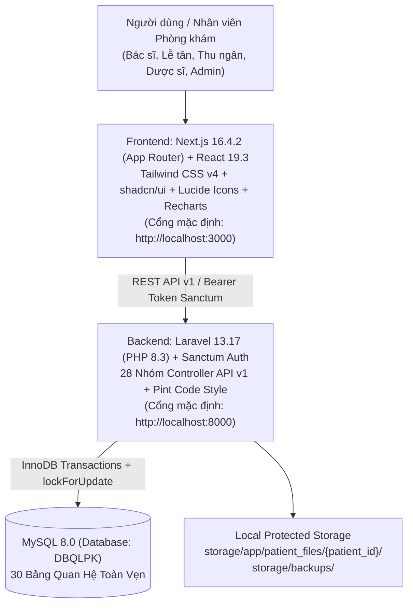

# HỒ SƠ TỔNG QUAN TOÀN BỘ DỰ ÁN (`PROJECT_MASTER_CONTEXT.md`)
## HỆ THỐNG QUẢN LÝ PHÒNG KHÁM CHUYÊN NGHIỆP (CLINIC MANAGEMENT SYSTEM - QLPK)
### *Tài liệu Ngữ cảnh Cốt lõi dành cho Kỹ sư & Trợ lý AI trong mọi Phiên làm việc mới*

- **Mã tài liệu:** `docs/PROJECT_MASTER_CONTEXT.md`
- **Phiên bản:** `3.0.0`
- **Cập nhật lần cuối:** 2026-10-29T00:06:00+07:00
- **Nhánh Git triển khai:** `dev` (Tuyệt đối không merge/commit trực tiếp lên `main`)
- **Trạng thái tổng thể dự án:**
  - **Giai đoạn 1 (`PHASE-01`):** `30 / 30 Tasks DONE (100%)` — Hoàn tất nền tảng Core Clinical & RBAC.
  - **Giai đoạn 2 (`PHASE-02`):** `30 / 30 Tasks DONE (100%)` — Hoàn tất Tài chính, Kho Dược, Báo cáo & UI Design System.
  - **Giai đoạn 3 (`PHASE-03`):** `25 / 30 Tasks DONE (83.3%)` — Đang hoàn thiện 5 task cuối (Khôi phục CSDL, Composite Indexes, N+1 Query, E2E Test Suite, Báo cáo & Nghiệm thu).

---

## 1. KIẾN TRÚC CÔNG NGHỆ VÀ MÔI TRƯỜNG DỰ ÁN

### Chi tiết Stack Kỹ thuật:
* **Backend (`be/`):**
  * Framework: Laravel `^13.17`, PHP `^8.3`.
  * Authentication: Laravel Sanctum (`auth:sanctum` + middleware `active_user`).
  * Phân quyền: Role-Based Access Control (RBAC) với middleware `permission:resource.action`.
  * Cơ sở dữ liệu: MySQL 8.0 (`DBQLPK`), charset `utf8mb4_unicode_ci`.
  * Kiểm thử & Linter: PHPUnit `^12.5` (`php artisan test`), Laravel Pint (`./vendor/bin/pint --test`).
* **Frontend (`fe/`):**
  * Framework: Next.js `16.4.2` (App Router), React `19.3.0`, TypeScript `5`.
  * Styling & UI: Tailwind CSS `v4`, **`shadcn/ui`** (tại `fe/components/ui/`), **`lucide-react`** icon.
  * Trực quan hóa dữ liệu: **`recharts`** (Donut Chart, Bar Chart, Area Chart).
  * Quản trị Layout: `AdminShell.tsx` (Sidebar 4 nhóm điều hướng thu gọn được, Topbar chuông thông báo, Theme Dark/Light).
* **Quy tắc An toàn Tối thượng:**
  1. **Zero Data Destruction:** Tuyệt đối không chạy lệnh xóa bảng (`migrate:fresh`, `migrate:reset`, `db:wipe`). Toàn bộ 30 bảng đang lưu giữ dữ liệu thực tế trên `DBQLPK`.
  2. **Git Branch Protection:** Toàn bộ công việc phát triển và commit thực hiện trên nhánh `dev`.
  3. **Concurrency Safety:** Mọi giao dịch tiền tệ (`Invoices`, `Payments`, `Expenses`, `CashTransactions`) và trừ tồn kho (`InventoryTransactions`) bắt buộc dùng `DB::transaction()` kết hợp khóa bi quan `lockForUpdate()`.
  4. **Medical Integrity:** Không để AI tự chẩn đoán hay kê đơn; hồ sơ bệnh án phải có audit trail khi chỉnh sửa.

---

## 2. MA TRẬN 30 BẢNG CƠ SỞ DỮ LIỆU MYSQL (`DBQLPK`)

Hệ thống được thiết kế chuẩn hóa 3NF bao gồm 30 bảng quan hệ chặt chẽ:

| STT | Tên Bảng | Eloquent Model | Vai trò Nghiệp vụ |
|:---:|---|---|---|
| 1 | `users` | `User.php` | Tài khoản đăng nhập, trạng thái ACTIVE/INACTIVE, liên kết nhân viên |
| 2 | `roles` | `Role.php` | 8 vai trò hệ thống: ADMIN, MANAGER, DOCTOR, NURSE, PHARMACIST, RECEPTIONIST, CASHIER, ACCOUNTANT |
| 3 | `permissions` | `Permission.php` | Danh mục quyền chi tiết theo chuẩn `resource.action` (ví dụ: `patients.view`, `invoices.create`) |
| 4 | `role_permissions` | Pivot table | Bảng quan hệ Nhiều - Nhiều giữa Role và Permission |
| 5 | `user_roles` | Pivot table | Bảng quan hệ Nhiều - Nhiều giữa User và Role |
| 6 | `departments` | `Department.php` | Chuyên khoa phòng khám (Nội, Ngoại, Răng Hàm Mặt, Sản, Nhi, Chẩn đoán hình ảnh,...) |
| 7 | `employees` | `Employee.php` | Thông tin nhân sự y tế: Bác sĩ, Điều dưỡng, Dược sĩ, Nhân viên tiếp đón |
| 8 | `patients` | `Patient.php` | Hồ sơ hành chính bệnh nhân, mã định danh `patient_code` duy nhất, tra cứu trùng lặp |
| 9 | `services` | `Service.php` | Danh mục dịch vụ kỹ thuật y tế, đơn giá, thời lượng thực hiện |
| 10 | `service_packages` | `ServicePackage.php` | Danh mục gói dịch vụ/liệu trình định kỳ nhiều buổi |
| 11 | `package_services` | Pivot table | Chi tiết các dịch vụ và định mức số lượt trong từng gói |
| 12 | `patient_packages` | `PatientPackage.php` | Gói dịch vụ đã cấp cho bệnh nhân, theo dõi số buổi đã dùng/còn lại |
| 13 | `appointments` | `Appointment.php` | Lịch hẹn khám bệnh: PENDING, CONFIRMED, COMPLETED, CANCELLED |
| 14 | `visits` | `Visit.php` | Lượt khám thực tế tại phòng khám: WAITING, IN_PROGRESS, COMPLETED, CANCELLED |
| 15 | `medical_records` | `MedicalRecord.php` | Bệnh án điện tử: Tiền sử, triệu chứng, chẩn đoán ICD, phác đồ điều trị, hẹn tái khám |
| 16 | `patient_files` | `PatientFile.php` | Tệp đính kèm y tế: Kết quả xét nghiệm PDF, hình ảnh X-quang, MRI, siêu âm |
| 17 | `invoices` | `Invoice.php` | Hóa đơn viện phí: Tổng tiền, giảm giá, bảo hiểm, đã trả, còn nợ |
| 18 | `invoice_items` | `InvoiceItem.php` | Chi tiết các dòng dịch vụ/thuốc trong hóa đơn |
| 19 | `payments` | `Payment.php` | Lịch sử các đợt thu tiền (Tiền mặt, Chuyển khoản, Thẻ) |
| 20 | `debts` | `Debt.php` | Sổ theo dõi công nợ bệnh nhân, đối soát số nợ phải thu |
| 21 | `expense_categories` | `ExpenseCategory.php` | Phân loại danh mục chi phí phòng khám (Điện nước, Thuê mặt bằng, Vật tư, Lương) |
| 22 | `expenses` | `Expense.php` | Phiếu chi tiền mặt hoặc chuyển khoản |
| 23 | `cash_transactions` | `CashTransaction.php` | Sổ quỹ tổng hợp dòng tiền thực thu và thực chi theo thời gian |
| 24 | `products` | `Product.php` | Danh mục thuốc và vật tư y tế tiêu hao, đơn vị tính, định mức tồn kho tối thiểu |
| 25 | `inventory_transactions` | `InventoryTransaction.php` | Nhật ký nhập kho, xuất kho bán lẻ/kê đơn, kiểm kê điều chỉnh (chống âm kho) |
| 26 | `kpi_targets` | `KpiTarget.php` | Chỉ tiêu doanh thu và lượt khám giao cho bác sĩ/nhân viên theo tháng/quý |
| 27 | `kpi_performances` | `KpiPerformance.php` | Thực đạt KPI tính toán tự động dựa trên hóa đơn và lượt khám thực tế |
| 28 | `audit_logs` | `AuditLog.php` | Nhật ký kiểm toán bất biến (Append-only) ghi vết hành động xem/sửa dữ liệu nhạy cảm |
| 29 | `alert_rules` | `AlertRule.php` | Cấu hình quy tắc cảnh báo tự động: Tồn kho thấp, nợ quá hạn, hủy lịch nhiều |
| 30 | `approval_requests` | `ApprovalRequest.php` | Luồng phê duyệt trực tuyến: Miễn giảm viện phí, xuất hủy thuốc, chi tiền lớn |

---

## 3. TÓM TẮT TIẾN ĐỘ 3 GIAI ĐOẠN

### GIAI ĐOẠN 1 (`PHASE-01`): NỀN TẢNG & LÂM SÀNG CỐT LÕI — `100% DONE`
* **Kết quả:** Xây dựng thành công kiến trúc Backend Laravel + Next.js App Router, schema 30 bảng MySQL, hệ thống đăng nhập Sanctum, phân quyền 8 Role RBAC, các module Bệnh nhân, Nhân viên, Dịch vụ, Lịch hẹn, Lượt khám, Bệnh án cơ bản.
* **Tài liệu lưu trữ:** [`docs/phase-1/PHASE_1_REPORT.md`](file:///Users/truongthinh/Documents/UIT/Manage%20Infomation/clinic-management-system/docs/phase-1/PHASE_1_REPORT.md), [`docs/phase-1/DATABASE_DESIGN.md`](file:///Users/truongthinh/Documents/UIT/Manage%20Infomation/clinic-management-system/docs/phase-1/DATABASE_DESIGN.md), [`docs/phase-1/API_DOCUMENTATION.md`](file:///Users/truongthinh/Documents/UIT/Manage%20Infomation/clinic-management-system/docs/phase-1/API_DOCUMENTATION.md).

### GIAI ĐOẠN 2 (`PHASE-02`): TÀI CHÍNH, KHO DƯỢC, BÁO CÁO & UI DESIGN SYSTEM — `100% DONE`
* **Kết quả:** Cài đặt toàn diện bộ component `shadcn/ui`, `lucide-react`, biểu đồ `recharts`; hoàn thiện module Hóa đơn thu tiền nhiều đợt, Sổ theo dõi công nợ, Phiếu chi và Sổ quỹ tự động, Kho dược chống xuất âm kho, Chỉ tiêu KPI nhân viên, Trung tâm Báo cáo quản trị, Import/Export dữ liệu CSV (kèm lưu vết lỗi `import_errors`), Chuông thông báo Topbar và Phê duyệt yêu cầu.
* **Tài liệu lưu trữ:** [`docs/phase-2/PHASE_2_REPORT.md`](file:///Users/truongthinh/Documents/UIT/Manage%20Infomation/clinic-management-system/docs/phase-2/PHASE_2_REPORT.md), [`docs/phase-2/PHASE_2_COMPLETION_SUMMARY.md`](file:///Users/truongthinh/Documents/UIT/Manage%20Infomation/clinic-management-system/docs/phase-2/PHASE_2_COMPLETION_SUMMARY.md), [`docs/phase-2/API_DOCUMENTATION_PHASE_2.md`](file:///Users/truongthinh/Documents/UIT/Manage%20Infomation/clinic-management-system/docs/phase-2/API_DOCUMENTATION_PHASE_2.md).

### GIAI ĐOẠN 3 (`PHASE-03`): NÂNG CẤP CHUYÊN SÂU, BỆNH ÁN ĐIỆN TỬ, TỆP Y TẾ & VẬN HÀNH — `21 / 30 TASKS DONE (70%)`
* **Các Feature đã hoàn thành 100%:**
  1. **`F3-01` — Audit toàn bộ hệ thống (`P3-001` → `P3-003`):** Lập báo cáo khảo sát chi tiết tại [`docs/phase-3/PHASE_3_AUDIT_REPORT.md`](file:///Users/truongthinh/Documents/UIT/Manage%20Infomation/clinic-management-system/docs/phase-3/PHASE_3_AUDIT_REPORT.md).
  2. **`F3-02` — Chuẩn hóa UI/UX toàn hệ thống (`P3-004` → `P3-009`):** Bảng dữ liệu không còn bị dồn cột (`whitespace-nowrap`, `overflow-x-auto`), Form có dấu `*` đỏ và chống gửi lặp, Dialog xác nhận thao tác nguy hiểm, Responsive đa màn hình. Nghiệm thu đạt 28/28 routes tại [`docs/phase-3/UI_STANDARDIZATION_REPORT.md`](file:///Users/truongthinh/Documents/UIT/Manage%20Infomation/clinic-management-system/docs/phase-3/UI_STANDARDIZATION_REPORT.md).
  3. **`F3-03` — Hồ sơ bệnh nhân & Bệnh án điện tử (`P3-010` → `P3-012`):** Trục thời gian khám bệnh lâm sàng (Clinical Timeline), màn hình khám bệnh chuyên môn cho bác sĩ, audit trail lịch sử chỉnh sửa bệnh án.
  4. **`F3-06` — Báo cáo & Biểu đồ chuyên nghiệp (`P3-019` → `P3-021`):** Donut Chart cơ cấu thanh toán/chi phí, Bar Chart so sánh KPI bác sĩ, Area Chart xu hướng doanh thu và lượt khám 12 tháng.
* **Các Feature đã hoàn thành phần lớn:**
  5. **`F3-04` — Lịch hẹn & Tiếp đón:** `P3-013` (máy trạng thái lịch hẹn) và `P3-014` (tiếp đón nhanh tại quầy) đã DONE.
  6. **`F3-05` — Quản lý tệp y tế:** `P3-017` (API download/stream tệp có quyền) và `P3-018` (UI kéo thả xem trước ảnh X-quang/PDF) đã DONE.
  7. **`F3-07` — Bảo mật & Kiểm toán:** `P3-022` (RBAC hồ sơ y tế) và `P3-024` (Data Masking che số điện thoại `0912***456`, Rate Limiting API) đã DONE.

---

## 4. CHI TIẾT 9 TASKS CÒN LẠI ĐỂ HOÀN TẤT DỰ ÁN

| Task ID | Feature | Mô tả Yêu cầu Kỹ thuật | File Cần Tác Động |
|---|---|---|---|
| **`P3-015`** | `F3-04` | Chuyển đổi nguyên tử từ Lịch hẹn sang Lượt khám chống trùng lặp (`check-in`) bằng `DB::transaction()` và `lockForUpdate()`. | `be/app/Http/Controllers/Api/V1/AppointmentController.php`, `fe/app/(admin)/appointments/page.tsx` |
| **`P3-016`** | `F3-05` | Xây dựng `PatientFileController` và API upload tệp đính kèm y tế (`patient_files`) với kiểm tra MIME an toàn. *(Lưu ý: API download P3-017 và UI P3-018 đã hoàn thành xong trước đó)*. | `be/app/Http/Controllers/Api/V1/PatientFileController.php`, `be/app/Http/Requests/PatientFile/*` |
| **`P3-023`** | `F3-07` | Bổ sung ghi log kiểm toán khi xuất file CSV, tải file y tế; viết `AuditLogTest`. | `be/app/Models/AuditLog.php`, `be/app/Http/Controllers/Api/V1/AuditLogController.php` |
| **`P3-025`** | `F3-08` | Hoàn tất script sao lưu CSDL tự động nén gzip. *(Mã nguồn script đã viết xong 409 dòng tại `scripts/backup-db.sh`, chỉ cần chmod +x và verify dry-run)*. | `scripts/backup-db.sh` |
| **`P3-026`** | `F3-08` | Xây dựng script khôi phục CSDL an toàn kèm dry-run `scripts/restore-db.sh` và sổ tay cứu hộ `docs/phase-3/DISASTER_RECOVERY_RUNBOOK.md`. | `scripts/restore-db.sh`, `docs/phase-3/DISASTER_RECOVERY_RUNBOOK.md` |
| **`P3-027`** | `F3-09` | Migration tạo Composite Indexes trên MySQL (`visits`, `appointments`, `invoices`, `cash_transactions`) để tối ưu tốc độ lọc/tìm kiếm. | `be/database/migrations/*_add_phase_3_composite_indexes.php` |
| **`P3-028`** | `F3-09` | Tối ưu truy vấn Eloquent, triệt tiêu N+1 Query và tối ưu phân trang các danh sách lớn. | `be/app/Http/Controllers/Api/V1/*` |
| **`P3-029`** | `F3-10` | Viết bộ kiểm thử tích hợp E2E trọn vẹn toàn bộ luồng nghiệp vụ phòng khám (Tiếp nhận -> Khám -> Đơn -> Kho -> Hóa đơn -> Thanh toán -> Sổ quỹ). | `be/tests/Feature/EndToEndPhase3WorkflowTest.php` |
| **`P3-030`** | `F3-10` | Tổng nghiệm thu toàn diện hệ thống, biên soạn Báo cáo hoàn thành `PHASE_3_REPORT.md` và Hướng dẫn Vận hành `OPERATIONAL_GUIDE.md`. | `docs/phase-3/PHASE_3_REPORT.md`, `docs/phase-3/OPERATIONAL_GUIDE.md` |

---

## 5. HƯỚNG DẪN KỸ SƯ / AI VÀO CA LÀM VIỆC TIẾP THEO

Khi bắt đầu một phiên làm việc mới (hoặc dùng tài khoản Antigravity mới):
1. **Kiểm tra trạng thái dự án:**
   - Nhánh Git: `dev`. Lệnh kiểm tra: `git status && git branch`.
   - Xem tiến độ: [`qlpk-autonomous-framework/PROGRESS.md`](file:///Users/truongthinh/Documents/UIT/Manage%20Infomation/clinic-management-system/qlpk-autonomous-framework/PROGRESS.md) và [`docs/phase-3/PHASE_3_PROGRESS_HANDOVER.md`](file:///Users/truongthinh/Documents/UIT/Manage%20Infomation/clinic-management-system/docs/phase-3/PHASE_3_PROGRESS_HANDOVER.md).
2. **Khởi động môi trường thử nghiệm (nếu cần):**
   - Backend: `cd be && php artisan serve` (chạy trên port 8000).
   - Frontend: `cd fe && npm run dev` (chạy trên port 3000).
   - Chạy test PHP: `cd be && php artisan test`.
   - Build FE: `cd fe && npm run build`.
3. **Cách hoàn thành 9 task còn lại:**
   - Có thể yêu cầu AI trong chat: *"Hãy đọc tài liệu docs/phase-3/PHASE_3_PROGRESS_HANDOVER.md và tiếp tục triển khai 9 task còn lại của Phase 3 từ P3-015, P3-016, P3-025 đến P3-030"*. AI sẽ thực thi trực tiếp, nhanh chóng và tiết kiệm tối đa quota token.
