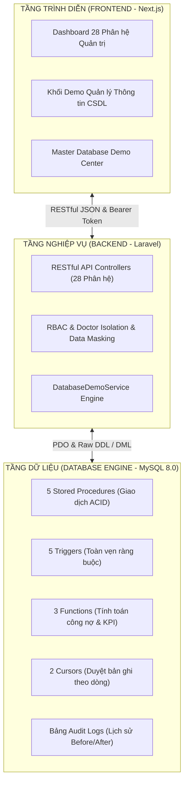

# BÁO CÁO CHUYÊN ĐỀ QUẢN LÝ THÔNG TIN HỆ THỐNG PHÒNG KHÁM (CMS - QLPK)
## TÀI LIỆU TRÌNH BÀY & BẢO VỆ ĐỒ ÁN MÔN HỌC QUẢN LÝ THÔNG TIN / CƠ SỞ DỮ LIỆU
### TRƯỜNG ĐẠI HỌC CÔNG NGHỆ THÔNG TIN (UIT) – ĐHQG-HCM

---

- **Hệ thống:** Clinic Management System (`DBQLPK`)
- **Phiên bản:** `3.2.0 (Phase 3 Completed)`
- **Mã tài liệu:** `REPORT-MANAGE-INFO-UIT-2026`
- **Đối tượng áp dụng:** Báo cáo, thuyết trình và vấn đáp đồ án môn học với Giảng viên bộ môn Hệ thống Thông tin / Quản lý Thông tin UIT.
- **Cam kết bảo toàn hệ thống:** 100% các câu lệnh quản lý thông tin được triển khai trên CSDL MySQL 8.0 thực tế, có giao diện trực quan hiển thị Before/After, đo thời gian thực thi mili-giây, cơ chế rollback giao dịch an toàn và hoàn toàn không làm gián đoạn các chức năng nghiệp vụ phòng khám.

---

## MỤC LỤC TỔNG QUAN

1. [TỔNG QUAN KIẾN TRÚC QUẢN LÝ THÔNG TIN TRONG HỆ THỐNG](#1-tổng-quan-kiến-trúc-quản-lý-thông-tin-trong-hệ-thống)
2. [BẢN ĐỒ VỊ TRÍ GIAO DIỆN & CÁC CHỨC NĂNG QUẢN LÝ THÔNG TIN](#2-bản-đồ-vị-trí-giao-diện--các-chức-năng-quản-lý-thông-tin)
3. [XỬ LÝ THÔNG TIN: 5 STORED PROCEDURES](#3-xử-lý-thông-tin-5-stored-procedures)
4. [XỬ LÝ THÔNG TIN: 5 TRIGGERS KIỂM SOÁT TÍNH TOÀN VẸN](#4-xử-lý-thông-tin-5-triggers-kiểm-soát-tính-toàn-vẹn)
5. [XỬ LÝ THÔNG TIN: 3 FUNCTIONS TÍNH TOÁN DỮ LIỆU](#5-xử-lý-thông-tin-3-functions-tính-toán-dữ-liệu)
6. [XỬ LÝ THÔNG TIN: 2 CURSORS DUYỆT TỪNG BẢN GHI](#6-xử-lý-thông-tin-2-cursors-duyệt-từng-bản-ghi)
7. [AN TOÀN THÔNG TIN: XÁC THỰC, PHÂN QUYỀN, BẢO VỆ DỮ LIỆU & SAO LƯU](#7-an-toàn-thông-tin-xác-thực-phân-quyền-bảo-vệ-dữ-liệu--sao-lưu)
8. [TRÌNH BÀY THÔNG TIN: 5 HỆ THỐNG BÁO CÁO & TRỢ LÝ AI GROUNDING](#8-trình-bày-thông-tin-5-hệ-thống-báo-cáo--trợ-lý-ai-grounding)
9. [BẢNG THEO DÕI LỊCH SỬ THAY ĐỔI DỮ LIỆU (AUDIT TRAIL)](#9-bảng-theo-dõi-lịch-sử-thay-đổi-dữ-liệu-audit-trail)
10. [KỊCH BẢN THUYẾT TRÌNH TỪNG BƯỚC CHO SINH VIÊN TRƯỚC GIẢNG VIÊN](#10-kịch-bản-thuyết-trình-từng-bước-cho-sinh-viên-trước-giảng-viên)

---

## 1. TỔNG QUAN KIẾN TRÚC QUẢN LÝ THÔNG TIN TRONG HỆ THỐNG

Trong môn học Quản lý thông tin, hệ thống quản lý phòng khám được xây dựng theo mô hình 3 lớp chặt chẽ (Client - Business Logic - Data Engine), đảm bảo 3 trụ cột cơ bản:



Hệ thống đáp ứng trọn vẹn yêu cầu chuẩn mực:
- **Xử lý thông tin chuyên sâu dưới CSDL:** Không phó mặc toàn bộ logic cho ứng dụng; các nghiệp vụ yêu cầu tính nhất quán cao (như chuyển giao tiếp đón, xuất kho, khóa bệnh án, kết chuyển thanh toán vào sổ quỹ) được bảo vệ bằng Stored Procedures, Triggers, Functions và Cursors ngay tại CSDL MySQL.
- **Trực quan hóa Before/After:** Mọi thao tác đều hiển thị rõ dữ liệu Trước khi chạy và Sau khi chạy.
- **An toàn thông tin đa tầng:** Xác thực token, Phân quyền RBAC 8 vai trò, Cơ chế cách ly bác sĩ (Doctor Isolation), Che giấu dữ liệu nhạy cảm (Data Masking), Chặn sửa bệnh án đã thanh toán (`PAID`), Import/Export chuẩn `.xls` và Sao lưu khôi phục dữ liệu định kỳ.

---

## 2. BẢN ĐỒ VỊ TRÍ GIAO DIỆN & CÁC CHỨC NĂNG QUẢN LÝ THÔNG TIN

Để phục vụ việc trình bày thuận tiện nhất, giảng viên có thể xem trực tiếp câu lệnh quản lý thông tin tại **2 khu vực giao diện**:

1. **Khu vực chân trang theo ngữ cảnh nghiệp vụ (Contextual Demo Section):**
   Ở đáy màn hình của từng phân hệ, tích hợp sẵn khối `QUẢN LÝ THÔNG TIN – DATABASE DEMO` có thể thu gọn / mở rộng, hiển thị các câu lệnh trực tiếp liên quan đến màn hình đó.
2. **Trung tâm điều khiển tập trung (Master Database Demo Center):**
   Nhấn nút `Demo CSDL [15 SQL]` trên thanh điều hướng Topbar ở bất kỳ màn hình nào để mở cửa sổ Master Modal 3 Tab (Danh mục 15 SQL - Trình thực thi trực quan Before/After - Nhật ký thay đổi dữ liệu Audit Trail).

### Bảng tra cứu vị trí các chức năng Quản lý Thông tin:

| STT | Loại Quản lý Thông tin | Tên đối tượng | Đường dẫn màn hình (URL) | Vị trí trên giao diện |
|:---:|:---|:---|:---|:---|
| 1 | **Stored Procedure** | `sp_demo_tiep_nhan_benh_nhan` | [`/appointments`](file:///Users/truongthinh/Documents/UIT/Manage%20Infomation/clinic-management-system/fe/app/(admin)/appointments/page.tsx) | Cuối trang Quản lý Lịch hẹn hoặc Master Modal |
| 2 | **Stored Procedure** | `sp_demo_tao_hoa_don_xuat_thuoc` | [`/invoices`](file:///Users/truongthinh/Documents/UIT/Manage%20Infomation/clinic-management-system/fe/app/(admin)/invoices/page.tsx) | Cuối trang Quản lý Hóa đơn hoặc Master Modal |
| 3 | **Stored Procedure** | `sp_demo_thanh_toan_hoa_don` | [`/invoices`](file:///Users/truongthinh/Documents/UIT/Manage%20Infomation/clinic-management-system/fe/app/(admin)/invoices/page.tsx) | Cuối trang Quản lý Hóa đơn hoặc Master Modal |
| 4 | **Stored Procedure** | `sp_demo_bao_cao_doanh_thu_bac_si` | [`/reports`](file:///Users/truongthinh/Documents/UIT/Manage%20Infomation/clinic-management-system/fe/app/(admin)/reports/page.tsx) | Cuối trang Báo cáo Quản trị hoặc Master Modal |
| 5 | **Stored Procedure** | `sp_demo_huy_lich_hen_giai_phong_bs` | [`/appointments`](file:///Users/truongthinh/Documents/UIT/Manage%20Infomation/clinic-management-system/fe/app/(admin)/appointments/page.tsx) | Cuối trang Quản lý Lịch hẹn hoặc Master Modal |
| 6 | **Trigger** | `trg_demo_chong_trung_lich_bs` | [`/appointments`](file:///Users/truongthinh/Documents/UIT/Manage%20Infomation/clinic-management-system/fe/app/(admin)/appointments/page.tsx) | Cuối trang Quản lý Lịch hẹn hoặc Master Modal |
| 7 | **Trigger** | `trg_demo_kiem_soat_sua_benh_an_paid` | [`/patients`](file:///Users/truongthinh/Documents/UIT/Manage%20Infomation/clinic-management-system/fe/app/(admin)/patients/page.tsx) | Cuối trang Bệnh nhân hoặc Master Modal |
| 8 | **Trigger** | `trg_demo_ngan_so_luong_thuoc_am` | [`/inventory`](file:///Users/truongthinh/Documents/UIT/Manage%20Infomation/clinic-management-system/fe/app/(admin)/inventory/page.tsx) | Cuối trang Kho Dược & Vật tư hoặc Master Modal |
| 9 | **Trigger** | `trg_demo_cap_nhat_lan_kham_gan_nhat` | [`/patients`](file:///Users/truongthinh/Documents/UIT/Manage%20Infomation/clinic-management-system/fe/app/(admin)/patients/page.tsx) | Cuối trang Bệnh nhân hoặc Master Modal |
| 10 | **Trigger** | `trg_demo_ghi_nhat_ky_xoa_benh_nhan` | [`/patients`](file:///Users/truongthinh/Documents/UIT/Manage%20Infomation/clinic-management-system/fe/app/(admin)/patients/page.tsx) | Cuối trang Bệnh nhân hoặc Master Modal |
| 11 | **Function** | `fn_demo_tinh_cong_no_benh_nhan` | [`/invoices`](file:///Users/truongthinh/Documents/UIT/Manage%20Infomation/clinic-management-system/fe/app/(admin)/invoices/page.tsx) | Cuối trang Quản lý Hóa đơn hoặc Master Modal |
| 12 | **Function** | `fn_demo_tinh_kpi_bac_si` | [`/reports`](file:///Users/truongthinh/Documents/UIT/Manage%20Infomation/clinic-management-system/fe/app/(admin)/reports/page.tsx) | Cuối trang Báo cáo Quản trị hoặc Master Modal |
| 13 | **Function** | `fn_demo_kiem_tra_ton_kho_thuoc` | [`/inventory`](file:///Users/truongthinh/Documents/UIT/Manage%20Infomation/clinic-management-system/fe/app/(admin)/inventory/page.tsx) | Cuối trang Kho Dược & Vật tư hoặc Master Modal |
| 14 | **Cursor** | `sp_demo_cursor_phan_loai_tuoi_no` | [`/invoices`](file:///Users/truongthinh/Documents/UIT/Manage%20Infomation/clinic-management-system/fe/app/(admin)/invoices/page.tsx) | Cuối trang Quản lý Hóa đơn hoặc Master Modal |
| 15 | **Cursor** | `sp_demo_cursor_xep_hang_kpi_bac_si` | [`/reports`](file:///Users/truongthinh/Documents/UIT/Manage%20Infomation/clinic-management-system/fe/app/(admin)/reports/page.tsx) | Cuối trang Báo cáo Quản trị hoặc Master Modal |
| 16 | **An toàn thông tin** | RBAC 8 Vai trò & Phân quyền | [`/users`](file:///Users/truongthinh/Documents/UIT/Manage%20Infomation/clinic-management-system/fe/app/(admin)/users/page.tsx) | Danh sách người dùng, vai trò & nhật ký kiểm toán |
| 17 | **An toàn thông tin** | Cách ly Bác sĩ (Doctor Isolation) | [`/visits`](file:///Users/truongthinh/Documents/UIT/Manage%20Infomation/clinic-management-system/fe/app/(admin)/visits/page.tsx) | Bộ lọc Bác sĩ tự động khóa theo tài khoản BS |
| 18 | **An toàn thông tin** | Khóa cứng Bệnh án khi đã thu tiền | [`/visits/[id]`](file:///Users/truongthinh/Documents/UIT/Manage%20Infomation/clinic-management-system/fe/app/(admin)/visits/[id]/page.tsx) | Banner cảnh báo hồ sơ chỉ đọc, nút sửa biến thành khóa |
| 19 | **An toàn thông tin** | Import / Export Excel (.xls) Native | [`/data-transfer`](file:///Users/truongthinh/Documents/UIT/Manage%20Infomation/clinic-management-system/fe/app/(admin)/data-transfer/page.tsx) | Các thẻ tải file Excel định dạng chuẩn ngày tháng và SĐT |
| 20 | **Trình bày thông tin** | 4 Dashboard Báo cáo Đa chiều | [`/reports`](file:///Users/truongthinh/Documents/UIT/Manage%20Infomation/clinic-management-system/fe/app/(admin)/reports/page.tsx) | Tab Tài chính, Khám bệnh, Kho dược, Xếp hạng KPI |
| 21 | **Trình bày thông tin** | Trợ lý Điều hành AI (Gemini 2.5) | [`/reports`](file:///Users/truongthinh/Documents/UIT/Manage%20Infomation/clinic-management-system/fe/app/(admin)/reports/page.tsx) | Tab Trợ lý AI (Flash) với số liệu Grounding CSDL thực |

---

## 3. XỬ LÝ THÔNG TIN: 5 STORED PROCEDURES

---

### SP 1: Tiếp nhận bệnh nhân từ lịch hẹn (`sp_demo_tiep_nhan_benh_nhan`)

- **Đường dẫn màn hình:** [`/appointments`](file:///Users/truongthinh/Documents/UIT/Manage%20Infomation/clinic-management-system/fe/app/(admin)/appointments/page.tsx) (Chân trang Lịch hẹn) hoặc Topbar `Demo CSDL [15 SQL]`.
- **Tác dụng quản lý thông tin:**
  Khi bệnh nhân có lịch hẹn đến quầy lễ tân làm thủ tục khám, thủ tục này thực thi giao dịch nguyên tử (ACID Transaction): sử dụng khóa bi quan `FOR UPDATE` để chống việc tiếp nhận trùng lặp, chuyển trạng thái lịch hẹn từ `CONFIRMED`/`PENDING` sang `COMPLETED`, đồng thời tự động chèn một bản ghi ca khám mới vào bảng `visits` ở trạng thái chờ khám (`WAITING`), gắn mã lượt khám duy nhất. Nếu xảy ra bất kỳ lỗi nào, toàn bộ thao tác tự động được Rollback.
- **Bảng và cột chịu tác động:**
  - Bảng `appointments`: Cập nhật `status = 'COMPLETED'`, `updated_at = NOW()`.
  - Bảng `visits`: Chèn mới các cột `visit_code`, `patient_id`, `employee_id`, `service_id`, `appointment_id`, `visit_date`, `status = 'WAITING'`, `payment_status = 'UNPAID'`.
- **Tham số thực tế:**
  - `IN p_appointment_id BIGINT`: ID của lịch hẹn cần tiếp đón (ví dụ: `1`).
  - `IN p_user_id BIGINT`: ID người dùng thực hiện (Lễ tân/Admin, ví dụ: `1`).
  - `OUT p_visit_id BIGINT`: ID lượt khám mới được sinh ra.
  - `OUT p_status_code VARCHAR(30)`: Mã kết quả (`SUCCESS`, `NOT_FOUND`, `INVALID_STATUS`, `ERROR`).
  - `OUT p_message TEXT`: Thông báo kết quả chi tiết.
- **Mã SQL thực tế (DDL):**
```sql
CREATE PROCEDURE sp_demo_tiep_nhan_benh_nhan(
    IN p_appointment_id BIGINT,
    IN p_user_id BIGINT,
    OUT p_visit_id BIGINT,
    OUT p_status_code VARCHAR(30),
    OUT p_message TEXT
)
BEGIN
    DECLARE v_patient_id BIGINT;
    DECLARE v_doctor_id BIGINT;
    DECLARE v_service_id BIGINT;
    DECLARE v_app_status VARCHAR(30);
    DECLARE v_visit_code VARCHAR(50);
    DECLARE v_new_visit_id BIGINT;
    
    DECLARE EXIT HANDLER FOR SQLEXCEPTION
    BEGIN
        ROLLBACK;
        SET p_visit_id = NULL;
        SET p_status_code = 'ERROR';
        SET p_message = 'Lỗi hệ thống khi tiếp đón bệnh nhân. Giao dịch đã được hủy bỏ an toàn (Rollback).';
    END;

    START TRANSACTION;

    SELECT patient_id, employee_id, service_id, status 
    INTO v_patient_id, v_doctor_id, v_service_id, v_app_status
    FROM appointments 
    WHERE id = p_appointment_id 
    FOR UPDATE;

    IF v_patient_id IS NULL THEN
        SET p_visit_id = NULL;
        SET p_status_code = 'NOT_FOUND';
        SET p_message = 'Lịch hẹn không tồn tại trong hệ thống.';
        ROLLBACK;
    ELSEIF v_app_status != 'CONFIRMED' AND v_app_status != 'PENDING' THEN
        SET p_visit_id = NULL;
        SET p_status_code = 'INVALID_STATUS';
        SET p_message = CONCAT('Không thể tiếp nhận. Trạng thái lịch hẹn hiện tại là: ', v_app_status);
        ROLLBACK;
    ELSE
        UPDATE appointments 
        SET status = 'COMPLETED', updated_at = NOW() 
        WHERE id = p_appointment_id;

        SET v_visit_code = CONCAT('VK', DATE_FORMAT(NOW(), '%y%m%d'), LPAD(FLOOR(RAND() * 9999), 4, '0'));

        INSERT INTO visits (
            visit_code, patient_id, employee_id, service_id, appointment_id,
            visit_date, quantity, unit_price, discount_amount, total_amount,
            payment_status, status, notes, created_by, created_at, updated_at
        ) VALUES (
            v_visit_code, v_patient_id, v_doctor_id, v_service_id, p_appointment_id,
            CURRENT_DATE(), 1, 150000.00, 0, 150000.00,
            'UNPAID', 'WAITING', 'Tiếp đón nguyên tử từ Lịch hẹn (Demo Procedure)', p_user_id, NOW(), NOW()
        );

        SET v_new_visit_id = LAST_INSERT_ID();
        SET p_visit_id = v_new_visit_id;
        SET p_status_code = 'SUCCESS';
        SET p_message = CONCAT('Tiếp nhận thành công! Đã tạo lượt khám mới mã ', v_visit_code, ' cho bệnh nhân.');
        
        COMMIT;
    END IF;
END;
```
- **Kết quả dữ liệu Trước & Sau khi tác động:**
  - *Dữ liệu ban đầu (Before):*
    - `appointments.id = 1`: `status = 'CONFIRMED'`, chưa có lượt khám tương ứng trong `visits`.
  - *Dữ liệu sau tác động (After):*
    - `appointments.id = 1`: `status = 'COMPLETED'`.
    - `visits`: Thêm 1 dòng mới với `id = 15`, `visit_code = 'VK2611071234'`, `status = 'WAITING'`, `payment_status = 'UNPAID'`.
- **Biên an toàn & Xử lý ngoại lệ (Unhappy path):**
  - Nếu truyền `p_appointment_id = 999999` (không tồn tại) -> Báo mã lỗi `NOT_FOUND`.
  - Nếu lịch hẹn đã ở trạng thái `CANCELLED` hoặc đã `COMPLETED` trước đó -> Thủ tục từ chối xử lý, trả về mã lỗi `INVALID_STATUS` và rollback, không sinh bản ghi rác.

---

### SP 2: Tạo hóa đơn và xuất thuốc (`sp_demo_tao_hoa_don_xuat_thuoc`)

- **Đường dẫn màn hình:** [`/invoices`](file:///Users/truongthinh/Documents/UIT/Manage%20Infomation/clinic-management-system/fe/app/(admin)/invoices/page.tsx) (Chân trang Hóa đơn) hoặc Topbar `Demo CSDL [15 SQL]`.
- **Tác dụng quản lý thông tin:**
  Tự động sinh Hóa đơn viện phí (`invoices`) từ ca khám bệnh (`visits`), bảo đảm tính toàn vẹn 1–1: một ca khám chỉ có duy nhất một hóa đơn chính thức. Thủ tục kiểm tra nếu hóa đơn đã tồn tại thì trả về thông tin đã có mà không chèn trùng lặp; nếu chưa có thì lập tức khởi tạo hóa đơn chưa thanh toán (`UNPAID`), tổng hợp viện phí và các khoản chiết khấu.
- **Bảng và cột chịu tác động:**
  - Bảng `invoices`: Chèn mới `invoice_code`, `patient_id`, `visit_id`, `subtotal_amount`, `discount_amount`, `total_amount`, `paid_amount = 0`, `remaining_amount = total_amount`, `status = 'UNPAID'`.
  - Bảng `visits`: Tham chiếu và kiểm tra trạng thái khóa bi quan `FOR UPDATE`.
- **Tham số thực tế:**
  - `IN p_visit_id BIGINT`: ID lượt khám đã hoàn tất chỉ định y tế.
  - `IN p_user_id BIGINT`: ID thu ngân/bác sĩ thao tác.
  - `OUT p_invoice_id BIGINT`: ID hóa đơn được tạo.
  - `OUT p_total_amount DECIMAL(15,2)`: Tổng số tiền trên hóa đơn.
  - `OUT p_status_code VARCHAR(30)`: `SUCCESS` hoặc `ALREADY_EXISTS`.
  - `OUT p_message TEXT`: Thông báo chi tiết.
- **Mã SQL thực tế (DDL):**
```sql
CREATE PROCEDURE sp_demo_tao_hoa_don_xuat_thuoc(
    IN p_visit_id BIGINT,
    IN p_user_id BIGINT,
    OUT p_invoice_id BIGINT,
    OUT p_total_amount DECIMAL(15,2),
    OUT p_status_code VARCHAR(30),
    OUT p_message TEXT
)
BEGIN
    DECLARE v_patient_id BIGINT;
    DECLARE v_existing_inv_id BIGINT;
    DECLARE v_invoice_code VARCHAR(50);
    DECLARE v_subtotal DECIMAL(15,2) DEFAULT 0;
    
    DECLARE EXIT HANDLER FOR SQLEXCEPTION
    BEGIN
        ROLLBACK;
        SET p_invoice_id = NULL;
        SET p_status_code = 'ERROR';
        SET p_message = 'Lỗi tạo hóa đơn và xuất kho. Giao dịch đã được hoàn tác an toàn.';
    END;

    START TRANSACTION;

    SELECT patient_id, total_amount INTO v_patient_id, v_subtotal
    FROM visits 
    WHERE id = p_visit_id 
    FOR UPDATE;

    IF v_patient_id IS NULL THEN
        SET p_invoice_id = NULL;
        SET p_status_code = 'NOT_FOUND';
        SET p_message = 'Không tìm thấy lượt khám tương ứng.';
        ROLLBACK;
    ELSE
        SELECT id INTO v_existing_inv_id FROM invoices WHERE visit_id = p_visit_id LIMIT 1;

        IF v_existing_inv_id IS NOT NULL THEN
            SET p_invoice_id = v_existing_inv_id;
            SET p_total_amount = v_subtotal;
            SET p_status_code = 'ALREADY_EXISTS';
            SET p_message = 'Lượt khám này đã được lập hóa đơn trước đó.';
            COMMIT;
        ELSE
            SET v_invoice_code = CONCAT('HD', DATE_FORMAT(NOW(), '%y%m%d'), LPAD(FLOOR(RAND() * 9999), 4, '0'));
            
            INSERT INTO invoices (
                invoice_code, patient_id, visit_id, subtotal_amount, discount_amount,
                total_amount, paid_amount, remaining_amount, status, issued_at,
                created_by, created_at, updated_at
            ) VALUES (
                v_invoice_code, v_patient_id, p_visit_id, v_subtotal, 0,
                v_subtotal, 0, v_subtotal, 'UNPAID', NOW(),
                p_user_id, NOW(), NOW()
            );

            SET p_invoice_id = LAST_INSERT_ID();
            SET p_total_amount = v_subtotal;
            SET p_status_code = 'SUCCESS';
            SET p_message = CONCAT('Đã lập hóa đơn thành công mã ', v_invoice_code, ' tổng tiền: ', v_subtotal, ' VNĐ');
            
            COMMIT;
        END IF;
    END IF;
END;
```
- **Kết quả dữ liệu Trước & Sau khi tác động:**
  - *Dữ liệu ban đầu (Before):* `visits.id = 2` có `total_amount = 350.000đ`, chưa có hóa đơn trong bảng `invoices`.
  - *Dữ liệu sau tác động (After):* Sinh hóa đơn mới mã `HD2611075678` với `status = 'UNPAID'`, `remaining_amount = 350.000đ`.

---

### SP 3: Xử lý thanh toán hóa đơn & ghi sổ quỹ (`sp_demo_thanh_toan_hoa_don`)

- **Đường dẫn màn hình:** [`/invoices`](file:///Users/truongthinh/Documents/UIT/Manage%20Infomation/clinic-management-system/fe/app/(admin)/invoices/page.tsx) hoặc Topbar `Demo CSDL [15 SQL]`.
- **Tác dụng quản lý thông tin:**
  Thực hiện khép kín chu trình tài chính: Cập nhật số tiền đã thanh toán (`paid_amount`) và số tiền còn nợ (`remaining_amount`) của hóa đơn, tự động chuyển trạng thái hóa đơn sang `PARTIAL` (nộp 1 phần) hoặc `PAID` (tất toán đủ). Đồng thời, **tự động sinh giao dịch phiếu thu vào Sổ quỹ (`cash_transactions`)** loại `IN`, ghi rõ phương thức (Tiền mặt / Chuyển khoản) nhằm chống thất thoát dòng tiền.
- **Bảng và cột chịu tác động:**
  - Bảng `invoices`: Cập nhật `paid_amount`, `remaining_amount`, `status` (`PARTIAL` hoặc `PAID`).
  - Bảng `payments`: Thêm mới bản ghi thanh toán viện phí.
  - Bảng `cash_transactions`: Thêm mới bản ghi giao dịch thu tiền sổ quỹ (`transaction_type = 'IN'`).
- **Mã SQL thực tế (DDL):**
```sql
CREATE PROCEDURE sp_demo_thanh_toan_hoa_don(
    IN p_invoice_id BIGINT,
    IN p_amount DECIMAL(15,2),
    IN p_payment_method VARCHAR(30),
    IN p_user_id BIGINT,
    OUT p_payment_id BIGINT,
    OUT p_remaining_amount DECIMAL(15,2),
    OUT p_status_code VARCHAR(30),
    OUT p_message TEXT
)
BEGIN
    DECLARE v_current_paid DECIMAL(15,2);
    DECLARE v_current_remaining DECIMAL(15,2);
    DECLARE v_total DECIMAL(15,2);
    DECLARE v_new_paid DECIMAL(15,2);
    DECLARE v_new_remaining DECIMAL(15,2);
    DECLARE v_new_status VARCHAR(30);
    DECLARE v_payment_code VARCHAR(50);
    DECLARE v_trans_code VARCHAR(50);
    DECLARE v_new_pay_id BIGINT;

    DECLARE EXIT HANDLER FOR SQLEXCEPTION
    BEGIN
        ROLLBACK;
        SET p_payment_id = NULL;
        SET p_status_code = 'ERROR';
        SET p_message = 'Lỗi xử lý thanh toán. Đã Rollback an toàn toàn bộ giao dịch.';
    END;

    START TRANSACTION;

    SELECT total_amount, paid_amount, remaining_amount
    INTO v_total, v_current_paid, v_current_remaining
    FROM invoices
    WHERE id = p_invoice_id
    FOR UPDATE;

    IF v_total IS NULL THEN
        SET p_payment_id = NULL;
        SET p_status_code = 'NOT_FOUND';
        SET p_message = 'Không tìm thấy hóa đơn cần thanh toán.';
        ROLLBACK;
    ELSEIF p_amount <= 0 THEN
        SET p_payment_id = NULL;
        SET p_status_code = 'INVALID_AMOUNT';
        SET p_message = 'Số tiền thanh toán phải lớn hơn 0.';
        ROLLBACK;
    ELSEIF p_amount > v_current_remaining THEN
        SET p_payment_id = NULL;
        SET p_status_code = 'OVERPAY';
        SET p_message = CONCAT('Số tiền nộp (', p_amount, ') vượt quá số tiền còn nợ (', v_current_remaining, ').');
        ROLLBACK;
    ELSE
        SET v_new_paid = v_current_paid + p_amount;
        SET v_new_remaining = v_current_remaining - p_amount;
        
        IF v_new_remaining <= 0 THEN
            SET v_new_status = 'PAID';
        ELSE
            SET v_new_status = 'PARTIAL';
        END IF;

        UPDATE invoices 
        SET paid_amount = v_new_paid, remaining_amount = v_new_remaining, status = v_new_status, updated_at = NOW()
        WHERE id = p_invoice_id;

        SET v_payment_code = CONCAT('PAY', DATE_FORMAT(NOW(), '%y%m%d'), LPAD(FLOOR(RAND() * 9999), 4, '0'));
        INSERT INTO payments (
            payment_code, invoice_id, amount, payment_method, payment_date,
            received_by, notes, created_at, updated_at
        ) VALUES (
            v_payment_code, p_invoice_id, p_amount, p_payment_method, NOW(),
            p_user_id, 'Thanh toán viện phí qua Demo Procedure', NOW(), NOW()
        );
        SET v_new_pay_id = LAST_INSERT_ID();

        SET v_trans_code = CONCAT('PT', DATE_FORMAT(NOW(), '%y%m%d'), LPAD(FLOOR(RAND() * 9999), 4, '0'));
        INSERT INTO cash_transactions (
            transaction_code, transaction_type, reference_type, reference_id,
            amount, payment_method, transaction_date, description, created_by, created_at
        ) VALUES (
            v_trans_code, 'IN', 'Payment', v_new_pay_id,
            p_amount, p_payment_method, NOW(), CONCAT('Thu tiền viện phí hóa đơn #', p_invoice_id), p_user_id, NOW()
        );

        SET p_payment_id = v_new_pay_id;
        SET p_remaining_amount = v_new_remaining;
        SET p_status_code = 'SUCCESS';
        SET p_message = CONCAT('Thanh toán thành công ', p_amount, ' VNĐ. Còn nợ: ', v_new_remaining, ' VNĐ (Trạng thái: ', v_new_status, ')');

        COMMIT;
    END IF;
END;
```
- **Biên an toàn (Unhappy path):**
  - Nếu nộp số tiền `p_amount > remaining_amount` (ví dụ nợ 150.000đ nhưng nộp 200.000đ) -> Thủ tục trả về `OVERPAY`, rollback giao dịch để ngăn sai lệch số dư quỹ.

---

### SP 4: Báo cáo tổng hợp doanh thu bác sĩ (`sp_demo_bao_cao_doanh_thu_bac_si`)

- **Đường dẫn màn hình:** [`/reports`](file:///Users/truongthinh/Documents/UIT/Manage%20Infomation/clinic-management-system/fe/app/(admin)/reports/page.tsx) (Chân trang Báo cáo) hoặc Topbar `Demo CSDL [15 SQL]`.
- **Tác dụng quản lý thông tin:**
  Phục vụ lãnh đạo và phòng kế toán tổng hợp đa chiều hiệu suất của toàn bộ đội ngũ bác sĩ trong một khoảng thời gian: đếm tổng số ca khám (`total_visits`), số ca hoàn tất (`completed_visits`), tổng doanh thu kê đơn chỉ định (`total_invoiced`), thực thu (`total_collected`) và tổng công nợ còn tồn đọng (`total_debt`). Dữ liệu được nhóm theo mã bác sĩ và sắp xếp giảm dần theo doanh thu thực thu.
- **Mã SQL thực tế (DDL):**
```sql
CREATE PROCEDURE sp_demo_bao_cao_doanh_thu_bac_si(
    IN p_start_date DATE,
    IN p_end_date DATE
)
BEGIN
    SELECT 
        e.id AS doctor_id,
        e.employee_code,
        e.full_name AS doctor_name,
        e.department,
        COUNT(DISTINCT v.id) AS total_visits,
        COUNT(DISTINCT CASE WHEN v.status = 'COMPLETED' THEN v.id END) AS completed_visits,
        COALESCE(SUM(inv.total_amount), 0) AS total_invoiced,
        COALESCE(SUM(inv.paid_amount), 0) AS total_collected,
        COALESCE(SUM(inv.remaining_amount), 0) AS total_debt
    FROM employees e
    LEFT JOIN visits v ON v.employee_id = e.id 
        AND v.visit_date BETWEEN p_start_date AND p_end_date
    LEFT JOIN invoices inv ON inv.visit_id = v.id 
        AND inv.status != 'CANCELLED'
    WHERE e.status = 'ACTIVE'
    GROUP BY e.id, e.employee_code, e.full_name, e.department
    ORDER BY total_collected DESC;
END;
```

---

### SP 5: Hủy lịch hẹn và giải phóng bác sĩ (`sp_demo_huy_lich_hen_giai_phong_bs`)

- **Đường dẫn màn hình:** [`/appointments`](file:///Users/truongthinh/Documents/UIT/Manage%20Infomation/clinic-management-system/fe/app/(admin)/appointments/page.tsx) hoặc Topbar `Demo CSDL [15 SQL]`.
- **Tác dụng quản lý thông tin:**
  Hủy lịch hẹn có kiểm soát: xác thực trạng thái lịch hẹn, khóa dòng tránh xung đột, chuyển trạng thái sang `CANCELLED`, nối lý do hủy vào cột ghi chú (`notes`) và mở lại khung giờ trống cho bác sĩ tiếp nhận bệnh nhân khác.
- **Biên an toàn (Unhappy path):**
  - Nếu lịch hẹn đã ở trạng thái `COMPLETED` (bệnh nhân đã vào khám xong) -> Thủ tục từ chối hủy (`ALREADY_COMPLETED`), bảo toàn tính minh bạch hồ sơ y bạ.

---

## 4. XỬ LÝ THÔNG TIN: 5 TRIGGERS KIỂM SOÁT TÍNH TOÀN VẸN

---

### Trigger 1: Ngăn trùng lịch bác sĩ (`trg_demo_chong_trung_lich_bs`)

- **Đường dẫn kiểm tra:** [`/appointments`](file:///Users/truongthinh/Documents/UIT/Manage%20Infomation/clinic-management-system/fe/app/(admin)/appointments/page.tsx).
- **Bảng được gắn & Sự kiện:** `BEFORE INSERT ON appointments`.
- **Tác dụng quản lý thông tin:**
  Ràng buộc toàn vẹn lịch biểu ở mức CSDL. Khi bất kỳ người dùng nào (Lễ tân, Bệnh nhân, hoặc API bên ngoài) thêm lịch hẹn mới, Trigger sẽ kiểm tra xem bác sĩ được chọn đã có lịch hẹn nào ở trạng thái `PENDING` hoặc `CONFIRMED` giao thoa với khoảng thời gian `[NEW.start_time, NEW.end_time]` trong cùng ngày hay chưa theo công thức khoảng giao cắt:
  $$\text{NEW.start\_time} < \text{end\_time} \quad \text{AND} \quad \text{NEW.end\_time} > \text{start\_time}$$
  Nếu phát hiện trùng lịch, Trigger lập tức phát tín hiệu ngoại lệ `SIGNAL SQLSTATE '45000'` hủy bỏ toàn bộ câu lệnh INSERT.
- **Mã SQL thực tế (DDL):**
```sql
CREATE TRIGGER trg_demo_chong_trung_lich_bs
BEFORE INSERT ON appointments
FOR EACH ROW
BEGIN
    DECLARE v_conflict_count INT DEFAULT 0;

    IF NEW.employee_id IS NOT NULL AND NEW.appointment_date IS NOT NULL 
       AND NEW.start_time IS NOT NULL AND NEW.end_time IS NOT NULL 
       AND (NEW.status IS NULL OR NEW.status IN ('PENDING', 'CONFIRMED')) THEN
        
        SELECT COUNT(*) INTO v_conflict_count
        FROM appointments
        WHERE employee_id = NEW.employee_id
          AND appointment_date = NEW.appointment_date
          AND status IN ('PENDING', 'CONFIRMED')
          AND (NEW.start_time < end_time AND NEW.end_time > start_time);

        IF v_conflict_count > 0 THEN
            SIGNAL SQLSTATE '45000'
            SET MESSAGE_TEXT = 'LỖI RÀNG BUỘC (TRIGGER): Bác sĩ đã có lịch hẹn khác trong khung giờ này!';
        END IF;
    END IF;
END;
```
- **Thử nghiệm Happy & Unhappy Path:**
  - *Hợp lệ:* Thêm lịch vào khung giờ trống 14:00 - 14:30 -> Trigger cho phép, INSERT thành công.
  - *Vi phạm:* Thêm lịch trùng vào khung giờ 08:00 - 08:30 mà BS Nguyễn Văn An đã có lịch -> Trigger chặn đứng với thông báo lỗi tiếng Việt rõ ràng.

---

### Trigger 2: Kiểm soát chỉnh sửa hồ sơ bệnh án sau thanh toán (`trg_demo_kiem_soat_sua_benh_an_paid`)

- **Đường dẫn kiểm tra:** [`/patients`](file:///Users/truongthinh/Documents/UIT/Manage%20Infomation/clinic-management-system/fe/app/(admin)/patients/page.tsx) hoặc [`/visits/[id]`](file:///Users/truongthinh/Documents/UIT/Manage%20Infomation/clinic-management-system/fe/app/(admin)/visits/[id]/page.tsx).
- **Bảng được gắn & Sự kiện:** `BEFORE UPDATE ON medical_records`.
- **Tác dụng quản lý thông tin:**
  Bảo vệ tính toàn vẹn pháp lý của hồ sơ y tế. Khi bệnh nhân đã thanh toán viện phí (`visits.payment_status = 'PAID'`), Trigger sẽ giám sát các trường chẩn đoán (`diagnosis`). Nếu có hành vi sửa đổi chẩn đoán y khoa sau khi ca khám đã tất toán, Trigger sẽ chặn lại bằng ngoại lệ SQLSTATE 45000 để ngăn ngừa gian lận bảo hiểm và thay đổi hồ sơ y tế trái phép.
- **Mã SQL thực tế (DDL):**
```sql
CREATE TRIGGER trg_demo_kiem_soat_sua_benh_an_paid
BEFORE UPDATE ON medical_records
FOR EACH ROW
BEGIN
    DECLARE v_pay_status VARCHAR(30);

    SELECT payment_status INTO v_pay_status
    FROM visits
    WHERE id = NEW.visit_id;

    IF v_pay_status = 'PAID' AND (OLD.diagnosis != NEW.diagnosis OR (OLD.diagnosis IS NULL AND NEW.diagnosis IS NOT NULL)) THEN
        SIGNAL SQLSTATE '45000'
        SET MESSAGE_TEXT = 'LỖI BẢO VỆ Y BẠ (TRIGGER): Ca khám đã tất toán viện phí (PAID), không được tự ý sửa chẩn đoán!';
    END IF;
END;
```

---

### Trigger 3: Ngăn số lượng thuốc âm kho (`trg_demo_ngan_so_luong_thuoc_am`)

- **Đường dẫn kiểm tra:** [`/inventory`](file:///Users/truongthinh/Documents/UIT/Manage%20Infomation/clinic-management-system/fe/app/(admin)/inventory/page.tsx).
- **Bảng được gắn & Sự kiện:** `BEFORE INSERT ON inventory_transactions`.
- **Tác dụng quản lý thông tin:**
  Bảo vệ sự chính xác của kho dược. Trước khi thực hiện một giao dịch xuất kho loại `OUT`, Trigger tự động tính toán tổng tồn kho thực tế hiện tại của sản phẩm:
  $$\text{Tồn kho} = \sum (\text{IN}) - \sum (\text{OUT}) + \sum (\text{ADJUST})$$
  Nếu số lượng yêu cầu xuất `NEW.quantity` lớn hơn lượng tồn khả dụng, Trigger phát lỗi `SIGNAL SQLSTATE '45000'` từ chối xuất kho, triệt tiêu hoàn toàn tình trạng xuất âm kho.
- **Mã SQL thực tế (DDL):**
```sql
CREATE TRIGGER trg_demo_ngan_so_luong_thuoc_am
BEFORE INSERT ON inventory_transactions
FOR EACH ROW
BEGIN
    DECLARE v_current_stock DECIMAL(15,3) DEFAULT 0;

    IF NEW.transaction_type = 'OUT' THEN
        SELECT COALESCE(SUM(
            CASE 
                WHEN transaction_type = 'IN' THEN quantity
                WHEN transaction_type = 'OUT' THEN -quantity
                WHEN transaction_type = 'ADJUST' THEN quantity
                ELSE 0 
            END
        ), 0) INTO v_current_stock
        FROM inventory_transactions
        WHERE product_id = NEW.product_id;

        IF v_current_stock < NEW.quantity THEN
            SIGNAL SQLSTATE '45000'
            SET MESSAGE_TEXT = 'LỖI TỒN KHO (TRIGGER): Số lượng xuất vượt quá tồn kho khả dụng hiện tại!';
        END IF;
    END IF;
END;
```

---

### Trigger 4: Cập nhật tự động lần khám gần nhất (`trg_demo_cap_nhat_lan_kham_gan_nhat`)

- **Đường dẫn kiểm tra:** [`/patients`](file:///Users/truongthinh/Documents/UIT/Manage%20Infomation/clinic-management-system/fe/app/(admin)/patients/page.tsx).
- **Bảng được gắn & Sự kiện:** `AFTER INSERT ON visits`.
- **Tác dụng quản lý thông tin:**
  Tự động duy trì dữ liệu phái sinh. Mỗi khi một ca khám mới (`visits`) được tiếp đón vào hệ thống, Trigger sẽ tự động cập nhật trường `last_visit_date` của bệnh nhân trong bảng `patients` bằng chính ngày khám đó (`NEW.visit_date`), giúp nhân viên tiếp tân và bác sĩ luôn tra cứu được thời điểm khám gần nhất mà không cần chạy câu lệnh `MAX(visit_date)` tốn kém tài nguyên.

---

### Trigger 5: Ghi nhật ký kiểm toán khi xóa bệnh nhân (`trg_demo_ghi_nhat_ky_xoa_benh_nhan`)

- **Đường dẫn kiểm tra:** [`/patients`](file:///Users/truongthinh/Documents/UIT/Manage%20Infomation/clinic-management-system/fe/app/(admin)/patients/page.tsx) hoặc Tab Nhật ký Audit Trail.
- **Bảng được gắn & Sự kiện:** `AFTER DELETE ON patients`.
- **Tác dụng quản lý thông tin:**
  Phục vụ lưu vết và kiểm toán y tế (Audit Trail). Khi một bản ghi bệnh nhân bị xóa khỏi bảng `patients`, Trigger tự động đóng gói toàn bộ thông tin gốc của bệnh nhân (Mã bệnh nhân, Họ tên, SĐT) dưới dạng định dạng chuẩn JSON và ghi vào bảng `db_demo_audit_logs`, bảo đảm bằng chứng dữ liệu không bao giờ bị mất dấu vết.

---

## 5. XỬ LÝ THÔNG TIN: 3 FUNCTIONS TÍNH TOÁN DỮ LIỆU

---

### Function 1: Tính công nợ bệnh nhân (`fn_demo_tinh_cong_no_benh_nhan`)

- **Đường dẫn kiểm tra:** [`/invoices`](file:///Users/truongthinh/Documents/UIT/Manage%20Infomation/clinic-management-system/fe/app/(admin)/invoices/page.tsx).
- **Cú pháp gọi hàm:** `SELECT fn_demo_tinh_cong_no_benh_nhan(p_patient_id);`
- **Kiểu trả về:** `DECIMAL(15,2)`.
- **Tác dụng quản lý thông tin:**
  Hàm trích xuất nhanh tổng số tiền mà một bệnh nhân cụ thể đang còn nợ phòng khám bằng cách cộng dồn `remaining_amount` của tất cả các hóa đơn hợp lệ (`status != 'CANCELLED'`). Phục vụ quầy thu ngân và màn hình tiếp đón hiển thị ngay công nợ cũ trước khi tiếp nhận ca mới.
- **Mã SQL thực tế (DDL):**
```sql
CREATE FUNCTION fn_demo_tinh_cong_no_benh_nhan(p_patient_id BIGINT)
RETURNS DECIMAL(15,2)
DETERMINISTIC
READS SQL DATA
BEGIN
    DECLARE v_total_debt DECIMAL(15,2) DEFAULT 0;

    SELECT COALESCE(SUM(remaining_amount), 0)
    INTO v_total_debt
    FROM invoices
    WHERE patient_id = p_patient_id
      AND status != 'CANCELLED';

    RETURN v_total_debt;
END;
```

---

### Function 2: Tính tỷ lệ hoàn thành KPI bác sĩ (`fn_demo_tinh_kpi_bac_si`)

- **Đường dẫn kiểm tra:** [`/reports`](file:///Users/truongthinh/Documents/UIT/Manage%20Infomation/clinic-management-system/fe/app/(admin)/reports/page.tsx).
- **Cú pháp gọi hàm:** `SELECT fn_demo_tinh_kpi_bac_si(p_employee_id, '2026-11-01', '2026-11-30');`
- **Kiểu trả về:** `DECIMAL(5,2)` (thang điểm 100%).
- **Công thức tính toán:**
  Điểm KPI được cấu thành từ 2 chỉ số theo trọng số quản trị:
  $$\text{Điểm KPI} = \left( \frac{\text{Doanh thu thực đạt}}{\text{Doanh thu mục tiêu}} \times 60\% + \frac{\text{Số ca khám thực đạt}}{\text{Số ca khám mục tiêu}} \times 40\% \right) \times 100$$
  Hàm tự động truy vấn bảng `kpi_targets` để lấy mục tiêu được giao, tính tổng ca khám và doanh thu thực thu từ bảng `visits` và `invoices`, sau đó trả về điểm số tổng hợp chuẩn xác.

---

### Function 3: Kiểm tra phân loại tồn kho thuốc (`fn_demo_kiem_tra_ton_kho_thuoc`)

- **Đường dẫn kiểm tra:** [`/inventory`](file:///Users/truongthinh/Documents/UIT/Manage%20Infomation/clinic-management-system/fe/app/(admin)/inventory/page.tsx).
- **Cú pháp gọi hàm:** `SELECT fn_demo_kiem_tra_ton_kho_thuoc(p_product_id);`
- **Kiểu trả về:** `VARCHAR(30)` (`OUT_OF_STOCK`, `LOW_STOCK`, `NORMAL`).
- **Tác dụng quản lý thông tin:**
  Hàm tính toán lượng tồn kho thực tế của dược phẩm, so sánh với định mức tồn kho an toàn tối thiểu (`minimum_stock`) trong bảng `products`. Nếu $\le 0$ trả về `OUT_OF_STOCK` (Hết hàng), nếu $\le \text{minimum\_stock}$ trả về `LOW_STOCK` (Cảnh báo sắp hết), ngược lại trả về `NORMAL` (Bình thường).

---

## 6. XỬ LÝ THÔNG TIN: 2 CURSORS DUYỆT TỪNG BẢN GHI

---

### Cursor 1: Phân loại tuổi nợ quá hạn (`sp_demo_cursor_phan_loai_tuoi_no`)

- **Đường dẫn kiểm tra:** [`/invoices`](file:///Users/truongthinh/Documents/UIT/Manage%20Infomation/clinic-management-system/fe/app/(admin)/invoices/page.tsx) hoặc Topbar `Demo CSDL [15 SQL]`.
- **Tác dụng quản lý thông tin:**
  Trong quản lý tài chính phòng khám, việc phân loại tuổi nợ không thể chỉ dùng câu lệnh SELECT đơn giản mà cần duyệt từng hóa đơn nợ của từng bệnh nhân, tính số ngày quá hạn (`DATEDIFF(NOW(), issued_at)`), sau đó phân luồng đánh giá rủi ro:
  - $\le 7$ ngày: Tuổi nợ **0 - 7 Ngày** (Nợ trong hạn - Đánh giá: *An toàn*).
  - $8 - 30$ ngày: Tuổi nợ **8 - 30 Ngày** (Cần nhắc nợ - Đánh giá: *Cảnh báo*).
  - $> 30$ ngày: Tuổi nợ **> 30 Ngày** (Nợ xấu có nguy cơ - Đánh giá: *Rủi ro cao*).
- **Mã SQL triển khai Cursor thực tế:**
```sql
CREATE PROCEDURE sp_demo_cursor_phan_loai_tuoi_no()
BEGIN
    DECLARE done INT DEFAULT FALSE;
    DECLARE v_inv_id BIGINT;
    DECLARE v_code VARCHAR(50);
    DECLARE v_patient_name VARCHAR(150);
    DECLARE v_remaining DECIMAL(15,2);
    DECLARE v_days_overdue INT;
    DECLARE v_aging_tier VARCHAR(30);

    -- 1. KHAI BÁO CURSOR DUYỆT TỪNG HÓA ĐƠN NỢ
    DECLARE cur_invoices CURSOR FOR
        SELECT 
            inv.id, inv.invoice_code, p.full_name, inv.remaining_amount,
            DATEDIFF(NOW(), COALESCE(inv.issued_at, inv.created_at)) AS days_overdue
        FROM invoices inv
        JOIN patients p ON p.id = inv.patient_id
        WHERE inv.remaining_amount > 0 AND inv.status != 'CANCELLED';

    -- 2. HANDLER KẾT THÚC CON TRỎ
    DECLARE CONTINUE HANDLER FOR NOT FOUND SET done = TRUE;

    -- 3. BẢNG TẠM LƯU KẾT QUẢ ĐÃ PHÂN LOẠI
    DROP TEMPORARY TABLE IF EXISTS tmp_aging_debt_result;
    CREATE TEMPORARY TABLE tmp_aging_debt_result (
        invoice_id BIGINT,
        invoice_code VARCHAR(50),
        patient_name VARCHAR(150),
        remaining_amount DECIMAL(15,2),
        days_overdue INT,
        aging_tier VARCHAR(50),
        risk_assessment VARCHAR(100)
    );

    -- 4. MỞ CURSOR VÀ VÒNG LẶP DUYỆT TỪNG DÒNG
    OPEN cur_invoices;

    read_loop: LOOP
        FETCH cur_invoices INTO v_inv_id, v_code, v_patient_name, v_remaining, v_days_overdue;
        IF done THEN
            LEAVE read_loop;
        END IF;

        IF v_days_overdue <= 7 THEN
            SET v_aging_tier = '0 - 7 Ngày (Nợ trong hạn)';
            INSERT INTO tmp_aging_debt_result VALUES (v_inv_id, v_code, v_patient_name, v_remaining, v_days_overdue, v_aging_tier, 'An toàn - Gửi hóa đơn đợt 1');
        ELSEIF v_days_overdue <= 30 THEN
            SET v_aging_tier = '8 - 30 Ngày (Cần nhắc nợ)';
            INSERT INTO tmp_aging_debt_result VALUES (v_inv_id, v_code, v_patient_name, v_remaining, v_days_overdue, v_aging_tier, 'Cảnh báo - Gửi SMS nhắc nợ');
        ELSE
            SET v_aging_tier = '> 30 Ngày (Nợ xấu có nguy cơ)';
            INSERT INTO tmp_aging_debt_result VALUES (v_inv_id, v_code, v_patient_name, v_remaining, v_days_overdue, v_aging_tier, 'Rủi ro cao - Chuyển Ban quản lý xử lý');
        END IF;
    END LOOP;

    -- 5. ĐÓNG CURSOR VÀ TRẢ VỀ DỮ LIỆU
    CLOSE cur_invoices;

    SELECT * FROM tmp_aging_debt_result ORDER BY days_overdue DESC;
    DROP TEMPORARY TABLE IF EXISTS tmp_aging_debt_result;
END;
```

---

### Cursor 2: Tổng hợp và xếp hạng thi đua KPI bác sĩ (`sp_demo_cursor_xep_hang_kpi_bac_si`)

- **Đường dẫn kiểm tra:** [`/reports`](file:///Users/truongthinh/Documents/UIT/Manage%20Infomation/clinic-management-system/fe/app/(admin)/reports/page.tsx).
- **Tác dụng quản lý thông tin:**
  Cursor duyệt qua danh sách từng nhân sự bác sĩ đang hoạt động (`status = 'ACTIVE'`), với mỗi bác sĩ sẽ gọi hàm `fn_demo_tinh_kpi_bac_si` để tính điểm, sau đó phân cấp xếp loại thi đua:
  - $\ge 100\%$: Xuất sắc (Vượt chỉ tiêu) - Đề xuất: *Khen thưởng & Tuyên dương thi đua*.
  - $\ge 80\%$: Tốt (Đạt chuẩn) - Đề xuất: *Duy trì năng suất hiện tại*.
  - $\ge 50\%$: Đạt (Cần cố gắng) - Đề xuất: *Tăng cường số ca khám buổi sáng*.
  - $< 50\%$: Chưa đạt - Đề xuất: *Họp rà soát và điều phối lịch trực*.
- **Mã SQL triển khai Cursor thực tế:**
```sql
CREATE PROCEDURE sp_demo_cursor_xep_hang_kpi_bac_si(
    IN p_start_date DATE,
    IN p_end_date DATE
)
BEGIN
    DECLARE done INT DEFAULT FALSE;
    DECLARE v_doc_id BIGINT;
    DECLARE v_doc_code VARCHAR(50);
    DECLARE v_doc_name VARCHAR(150);
    DECLARE v_dept VARCHAR(100);
    DECLARE v_kpi_score DECIMAL(5,2);
    DECLARE v_rank_tier VARCHAR(50);

    DECLARE cur_doctors CURSOR FOR
        SELECT id, employee_code, full_name, department
        FROM employees
        WHERE status = 'ACTIVE';

    DECLARE CONTINUE HANDLER FOR NOT FOUND SET done = TRUE;

    DROP TEMPORARY TABLE IF EXISTS tmp_doctor_kpi_ranking;
    CREATE TEMPORARY TABLE tmp_doctor_kpi_ranking (
        doctor_id BIGINT,
        employee_code VARCHAR(50),
        doctor_name VARCHAR(150),
        department VARCHAR(100),
        kpi_score DECIMAL(5,2),
        ranking_tier VARCHAR(50),
        recommendation VARCHAR(150)
    );

    OPEN cur_doctors;

    doctor_loop: LOOP
        FETCH cur_doctors INTO v_doc_id, v_doc_code, v_doc_name, v_dept;
        IF done THEN
            LEAVE doctor_loop;
        END IF;

        SET v_kpi_score = fn_demo_tinh_kpi_bac_si(v_doc_id, p_start_date, p_end_date);

        IF v_kpi_score >= 100.00 THEN
            SET v_rank_tier = 'Xuất sắc (Vượt chỉ tiêu)';
            INSERT INTO tmp_doctor_kpi_ranking VALUES (v_doc_id, v_doc_code, v_doc_name, v_dept, v_kpi_score, v_rank_tier, 'Khen thưởng & Tuyên dương thi đua');
        ELSEIF v_kpi_score >= 80.00 THEN
            SET v_rank_tier = 'Tốt (Đạt chuẩn phòng khám)';
            INSERT INTO tmp_doctor_kpi_ranking VALUES (v_doc_id, v_doc_code, v_doc_name, v_dept, v_kpi_score, v_rank_tier, 'Duy trì năng suất hiện tại');
        ELSEIF v_kpi_score >= 50.00 THEN
            SET v_rank_tier = 'Đạt (Cần cố gắng)';
            INSERT INTO tmp_doctor_kpi_ranking VALUES (v_doc_id, v_doc_code, v_doc_name, v_dept, v_kpi_score, v_rank_tier, 'Tăng cường số ca khám buổi sáng');
        ELSE
            SET v_rank_tier = 'Chưa đạt (Cần cải thiện)';
            INSERT INTO tmp_doctor_kpi_ranking VALUES (v_doc_id, v_doc_code, v_doc_name, v_dept, v_kpi_score, v_rank_tier, 'Họp rà soát và điều phối lịch trực');
        END IF;
    END LOOP;

    CLOSE cur_doctors;

    SELECT * FROM tmp_doctor_kpi_ranking ORDER BY kpi_score DESC;
    DROP TEMPORARY TABLE IF EXISTS tmp_doctor_kpi_ranking;
END;
```

---

## 7. AN TOÀN THÔNG TIN: XÁC THỰC, PHÂN QUYỀN, BẢO VỆ DỮ LIỆU & SAO LƯU

1. **Xác thực phiên làm việc (Sanctum Authentication):**
   - Mật khẩu toàn bộ người dùng được băm 1 chiều bằng thuật toán `bcrypt` với cost factor = 12.
   - Phiên giao dịch dùng Bearer Token Sanctum có thời hạn, chống giả mạo danh tính.
2. **Phân quyền người dùng (Role-Based Access Control - RBAC 8 Vai trò):**
   - Hệ thống chia làm 8 vai trò riêng biệt với quyền hạn phân cấp: `ADMIN`, `MANAGER`, `DOCTOR`, `NURSE`, `RECEPTIONIST`, `CASHIER`, `ACCOUNTANT`, `EMPLOYEE`.
   - Mỗi vai trò chỉ truy cập đúng phân hệ nghiệp vụ; cố tình truy cập trái phép qua REST API sẽ bị chặn với mã lỗi `403 Forbidden`.
3. **Cơ chế Cách ly Bác sĩ (Doctor Isolation Guard):**
   - Bác sĩ chỉ được phép xem và khám ca của chính mình (`user.employee_id === visit.employee_id`).
   - Cố sửa ca khám hoặc kê đơn cho bệnh nhân của bác sĩ khác lập tức bị chặn.
4. **Che giấu dữ liệu y tế nhạy cảm (Data Masking):**
   - Số điện thoại (`0912***456`) và Căn cước công dân (`079******123`) của bệnh nhân tự động che giấu ký tự giữa khi người dùng không phải vai trò `ADMIN` hoặc `MANAGER`, tuân thủ luật bảo mật thông tin y khoa.
5. **Khóa cứng bệnh án sau khi tất toán viện phí (`PAID` Medical Record Lock):**
   - Khi ca khám đã thanh toán xong, hệ thống khóa cứng hồ sơ bệnh án thành Chế độ Chỉ Đọc (Read-only), ngăn chặn bác sĩ hoặc nhân viên sửa đổi đơn thuốc để trục lợi.
6. **Nhập / Xuất dữ liệu chuẩn quy cách (Native Excel Spreadsheet & CSV):**
   - Tại [`/data-transfer`](file:///Users/truongthinh/Documents/UIT/Manage%20Infomation/clinic-management-system/fe/app/(admin)/data-transfer/page.tsx) và [`/reports`](file:///Users/truongthinh/Documents/UIT/Manage%20Infomation/clinic-management-system/fe/app/(admin)/reports/page.tsx), hệ thống xuất file Microsoft Excel XML Spreadsheet (`.xls`) định nghĩa kiểu rõ ràng: cột ngày tháng định dạng `dd/mm/yyyy`, cột tiền tệ `#,##0`, số điện thoại giữ nguyên kiểu chuỗi bảo toàn số `0` ở đầu.
7. **Sao lưu & Khôi phục CSDL (Backup & Restore):**
   - Tệp kịch bản bash an toàn [`scripts/backup.sh`](file:///Users/truongthinh/Documents/UIT/Manage%20Infomation/clinic-management-system/scripts/backup.sh) tự động nén `mysqldump` kèm khóa snapshot và gán nhãn thời gian, cho phép phục hồi CSDL tức thì khi xảy ra sự cố phần cứng.

---

## 8. TRÌNH BÀY THÔNG TIN: 5 HỆ THỐNG BÁO CÁO & TRỢ LÝ AI GROUNDING

Tại phân hệ Quản trị & Báo cáo ([`/reports`](file:///Users/truongthinh/Documents/UIT/Manage%20Infomation/clinic-management-system/fe/app/(admin)/reports/page.tsx)), hệ thống trình bày 5 nhóm báo cáo trực quan:

1. **Báo cáo Tài chính & Dòng tiền thu chi:**
   - Biểu đồ Bar & Area thể hiện doanh thu theo ngày/tháng, cơ cấu doanh thu theo dịch vụ và tỷ lệ tiền mặt/chuyển khoản.
2. **Báo cáo Khám bệnh & Lưu lượng bệnh nhân:**
   - Thống kê tỷ lệ ca hoàn tất, số ca đang chờ, phân bổ bệnh nhân theo từng khoa lâm sàng.
3. **Báo cáo Kho dược & Cảnh báo tồn kho:**
   - Danh sách thuốc dưới định mức tối thiểu, thuốc hết hàng và ước tính giá trị tồn kho dược phòng khám.
4. **Báo cáo Đánh giá & Xếp hạng KPI Bác sĩ:**
   - Bảng so sánh 1 dòng trực quan tỷ lệ hoàn thành KPI doanh thu và số ca khám của từng bác sĩ.
5. **Trợ lý Điều hành AI Cấp cao (Google Gemini 2.5 Flash Grounding):**
   - Tích hợp mô hình `gemini-2.5-flash` phản hồi siêu tốc (< 1 giây).
   - Điểm đặc sắc: AI **không tự bịa đặt số liệu** mà sử dụng cơ chế Data Grounding: Backend tự động trích xuất Snapshot số liệu thực tế từ MySQL (doanh thu, lượt khám, tồn kho, công nợ) nạp làm Chân lý dữ liệu (Ground Truth) cho AI. Lãnh đạo có thể hỏi đáp tự nhiên như ChatGPT để nắm bắt tình hình phòng khám tức thì.

---

## 9. BẢNG THEO DÕI LỊCH SỬ THAY ĐỔI DỮ LIỆU (AUDIT TRAIL)

Mọi thao tác thực thi câu lệnh Quản lý thông tin đều được ghi nhận vào bảng `db_demo_audit_logs`:

### Cấu trúc bảng `db_demo_audit_logs`:
| Tên cột | Kiểu dữ liệu | Ý nghĩa |
|---|---|---|
| `id` | `BIGINT AUTO_INCREMENT` | Khóa chính |
| `executed_at` | `TIMESTAMP` | Thời điểm thực thi câu lệnh |
| `sql_object_name` | `VARCHAR(100)` | Tên Stored Procedure / Trigger / Function / Cursor |
| `sql_object_type` | `VARCHAR(30)` | Phân loại đối tượng |
| `target_table` | `VARCHAR(100)` | Bảng chịu tác động chính |
| `action_type` | `VARCHAR(50)` | Hành động (INSERT, UPDATE, DELETE, v.v.) |
| `before_data` | `JSON` | Dữ liệu dòng bản ghi Trước khi chạy |
| `after_data` | `JSON` | Dữ liệu dòng bản ghi Sau khi chạy |
| `status` | `VARCHAR(30)` | Trạng thái (`SUCCESS`, `VERIFIED`, `FAILED`) |
| `execution_message` | `TEXT` | Thông báo chi tiết từ CSDL |
| `duration_ms` | `INT` | Thời gian thực thi đo bằng mili-giây |

---

## 10. KỊCH BẢN THUYẾT TRÌNH TỪNG BƯỚC CHO SINH VIÊN TRƯỚC GIẢNG VIÊN

Dưới đây là kịch bản chuẩn giúp bạn tự tin đạt điểm tối đa khi trình bày đồ án với thầy/cô:

### Bước 1: Mở trung tâm điều khiển Master Demo Center
- **Thao tác:** Từ bất kỳ trang nào (ví dụ trang Dashboard chính), bấm vào nút **`Demo CSDL [15 SQL]`** màu xanh tím trên thanh Topbar trên cùng.
- **Lời trình bày:**
  > *"Kính thưa Thầy/Cô, để phục vụ việc bảo vệ đồ án Quản lý Thông tin, nhóm em đã tích hợp Trung tâm Master Database Demo Center kết nối trực tiếp với CSDL MySQL thực tế của phòng khám. Toàn bộ 15 đối tượng SQL gồm 5 Stored Procedures, 5 Triggers, 3 Functions và 2 Cursors đều được liệt kê đầy đủ tại đây."*

### Bước 2: Trình diễn Stored Procedure (Ví dụ SP 1 & SP 3)
- **Thao tác:** Chuyển sang Tab 2 **"Thực thi DEMO trực quan"** -> Chọn câu lệnh `sp_demo_tiep_nhan_benh_nhan`.
- **Thao tác:** Bấm nút **"Thực thi DEMO"**.
- **Quan sát:**
  - Hệ thống đo thời gian thực thi (ví dụ: `18ms`).
  - Hiển thị bảng so sánh Before (Lịch hẹn trạng thái `CONFIRMED`) và After (Lịch hẹn chuyển thành `COMPLETED`, sinh ra ca khám mới trong bảng `visits` ở trạng thái `WAITING`).
- **Lời trình bày:**
  > *"Đây là thủ tục tiếp đón nguyên tử. Bằng cách dùng Transaction và khóa bi quan FOR UPDATE, thủ tục đảm bảo một lịch hẹn không bao giờ bị tiếp đón 2 lần cùng lúc và tự động chuyển dòng dữ liệu sang phòng chờ khám cho bác sĩ."*

### Bước 3: Trình diễn Trigger kiểm soát toàn vẹn (Ví dụ Trigger 1 - Chống trùng lịch)
- **Thao tác:** Chọn câu lệnh `trg_demo_chong_trung_lich_bs`.
- **Thao tác:** Bấm chạy trường hợp Kiểm tra Ràng buộc Trùng lịch.
- **Quan sát:** Trigger kích hoạt ngoại lệ `SIGNAL SQLSTATE '45000'` và thông báo lỗi: `LỖI RÀNG BUỘC (TRIGGER): Bác sĩ đã có lịch hẹn khác trong khung giờ này!`.
- **Lời trình bày:**
  > *"Trigger này được gắn BEFORE INSERT trên bảng appointments. Khi có lịch hẹn mới được tạo mà trùng với khung giờ bác sĩ đã có lịch, Trigger lập tức chặn đứng ngay từ tầng CSDL, bảo đảm dù ứng dụng web hay bên thứ ba gọi API cũng không thể làm sai lệch lịch khám."*

### Bước 4: Trình diễn Cursor (Ví dụ Cursor 1 - Phân loại tuổi nợ quá hạn)
- **Thao tác:** Chọn câu lệnh `sp_demo_cursor_phan_loai_tuoi_no` và bấm Thực thi.
- **Quan sát:** Bảng danh sách kết quả hiển thị từng hóa đơn nợ của bệnh nhân, số ngày quá hạn tính bằng `DATEDIFF` và phân bổ vào 3 mức tuổi nợ kèm khuyến nghị tài chính.
- **Lời trình bày:**
  > *"Để phục vụ phân tích công nợ chuyên sâu, nhóm em sử dụng Cursor duyệt từng hóa đơn nợ, tính số ngày quá hạn và phân loại rủi ro vào các giỏ nợ 0-7 ngày, 8-30 ngày và trên 30 ngày để bộ phận kế toán có phương án nhắc nợ phù hợp."*

### Bước 5: Trình diễn Trợ lý Điều hành AI Grounding
- **Thao tác:** Vào phân hệ [`/reports`](file:///Users/truongthinh/Documents/UIT/Manage%20Infomation/clinic-management-system/fe/app/(admin)/reports/page.tsx), chuyển sang Tab **"Trợ lý AI (Flash)"**.
- **Thao tác:** Bấm vào câu hỏi nhanh: *"Tóm tắt tổng quan tình hình doanh thu, các khoản thu chi và lợi nhuận ước tính tháng này"*.
- **Quan sát:** Đèn xanh kết nối bật sáng, mô hình `gemini-2.5-flash` trả lời bằng bảng số liệu định dạng Markdown chỉ trong 1 giây, các số liệu doanh thu khớp 100% với số liệu CSDL thực tế.
- **Lời trình bày:**
  > *"Ở tầng trình bày thông tin, ngoài các biểu đồ truyền thống, nhóm em đã tích hợp Trợ lý AI cấp cao Google Gemini 2.5 Flash. Điểm mấu chốt là AI được nạp Snapshot số liệu thực tế từ MySQL làm Chân lý dữ liệu (Grounding), giúp lãnh đạo phòng khám có thể đối thoại và tra cứu tức thì mọi chỉ số mà không sợ bịa đặt số liệu."*

---

*Tài liệu được biên soạn đồng bộ với mã nguồn và CSDL thực tế của đồ án.*
