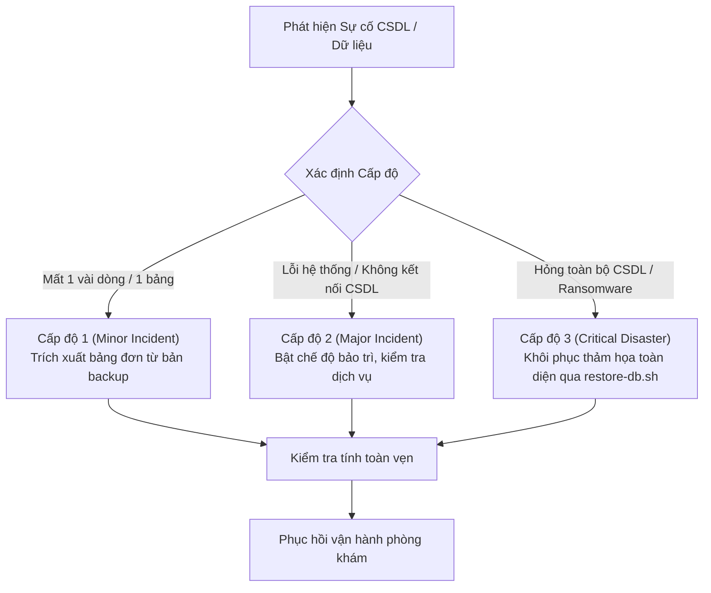

# SỔ TAY VẬN HÀNH KHÔI PHỤC THẢM HỌA (DISASTER RECOVERY RUNBOOK)
## HỆ THỐNG QUẢN LÝ PHÒNG KHÁM ĐA KHOA (QLPK) — GIAI ĐOẠN 3 (`PHASE-03`)

- **Mã tài liệu:** `SOP-DR-QLPK-01`
- **Phiên bản:** `1.0.0`
- **Ngày ban hành:** `2026-10-29`
- **Feature liên quan:** `F3-08` — Sao lưu, Khôi phục và Quy trình Vận hành
- **Task thực hiện:** `P3-026` (`F3-08-03` / `F3-08-04`)
- **Tập lệnh cốt lõi:**
  - Sao lưu tự động: [`scripts/backup-db.sh`](file:///Users/truongthinh/Documents/UIT/Manage%20Infomation/clinic-management-system/scripts/backup-db.sh)
  - Khôi phục an toàn: [`scripts/restore-db.sh`](file:///Users/truongthinh/Documents/UIT/Manage%20Infomation/clinic-management-system/scripts/restore-db.sh)

---

## 1. MỤC TIÊU & CHỈ SỐ CAM KẾT VẬN HÀNH (SLA)

Hệ thống Quản lý Phòng khám (`QLPK`) xử lý dữ liệu khám chữa bệnh, chỉ định cận lâm sàng, kho dược và giao dịch tài chính thời gian thực. Để bảo đảm tính liên tục và an toàn dữ liệu lâm sàng theo tiêu chuẩn Bộ Y tế, quy trình khôi phục thảm họa cam kết hai chỉ số:

| Chỉ số | Định nghĩa | Mục tiêu Cam kết (SLA) | Cơ chế Đảm bảo |
|---|---|---|---|
| **RPO** (*Recovery Point Objective*) | Lượng dữ liệu tối đa chấp nhận mất mát tính theo thời gian | **< 24 giờ** (Bản sao lưu hàng ngày lúc 02:00 AM) hoặc **< 15 phút** khi kích hoạt MySQL Binary Logs | Lịch sao lưu tự động qua Cron Job và lưu trữ Binary Log |
| **RTO** (*Recovery Time Objective*) | Thời gian tối đa để đưa hệ thống hoạt động trở lại sau sự cố | **< 15 phút** cho cơ sở dữ liệu tiêu chuẩn (dưới 5GB) | Quy trình khôi phục bán tự động có script hỗ trợ `restore-db.sh` |

---

## 2. PHÂN LOẠI CẤP ĐỘ SỰ CỐ (DISASTER SEVERITY LEVELS)



1. **Cấp độ 1 — Sự cố Cục bộ (Minor Incident):**
   - *Biểu hiện:* Xóa nhầm một số bản ghi, hỏng dữ liệu trên 1 bảng đơn lẻ (ví dụ: `medicines` hoặc `services`), ứng dụng vẫn hoạt động bình thường trên các phân hệ khác.
   - *Biện pháp:* Không cần dừng toàn bộ hệ thống; trích xuất dữ liệu của bảng bị ảnh hưởng từ tệp sao lưu gần nhất và khôi phục cục bộ.

2. **Cấp độ 2 — Gián đoạn Dịch vụ (Major Incident):**
   - *Biểu hiện:* Dịch vụ MySQL bị crash, đầy dung lượng ổ cứng dẫn đến cơ sở dữ liệu chuyển sang trạng thái read-only hoặc bảng InnoDB bị crash nhưng tệp dữ liệu vật lý chưa bị phá hủy.
   - *Biện pháp:* Kích hoạt chế độ bảo trì ứng dụng, giải phóng ổ đĩa, chạy lệnh sửa chữa InnoDB hoặc khôi phục snapshot gần nhất.

3. **Cấp độ 3 — Thảm họa Phá hủy Toàn diện (Critical Disaster):**
   - *Biểu hiện:* Hỏng toàn bộ ổ cứng lưu trữ CSDL, mã hóa tống tiền (Ransomware), lỗi vận hành nghiêm trọng (vô tình drop database), trung tâm dữ liệu gặp sự cố phần cứng không thể phục hồi.
   - *Biện pháp:* Khởi động toàn bộ quy trình khôi phục thảm họa theo chuẩn 8 bước của Sổ tay này trên máy chủ hiện tại hoặc máy chủ dự phòng (Failover Host).

---

## 3. VAI TRÒ & MA TRẬN ĐIỀU PHỐI KHẨN CẤP (INCIDENT RESPONSE TEAM)

| Vai trò | Người phụ trách | Trách nhiệm chính |
|---|---|---|
| **Chỉ huy Sự cố** (*Incident Commander*) | Trưởng phòng CNTT / Lead DevOps | Tuyên bố kích hoạt quy trình thảm họa, ra quyết định chọn bản sao lưu khôi phục và phê duyệt mở lại hệ thống. |
| **Kỹ sư Quản trị CSDL** (*Lead DBA*) | Senior Backend / Database Admin | Trực tiếp chạy các kịch bản `restore-db.sh`, kiểm tra tính toàn vẹn cấu trúc và dữ liệu 30 bảng MySQL. |
| **Kỹ sư Hạ tầng** (*DevOps / System Admin*) | Kỹ sư Vận hành Hạ tầng | Quản lý máy chủ, phân vùng ổ đĩa, phân quyền bảo mật, mạng và chứng chỉ SSL. |
| **Đại diện Lâm sàng & Nghiệp vụ** | Giám đốc Y khoa / Trưởng Lễ tân | Điều phối quy trình tiếp đón bệnh nhân thủ công (bằng giấy) trong thời gian hệ thống bảo trì. |

---

## 4. QUY TRÌNH 8 BƯỚC KHÔI PHỤC THẢM HỌA TIÊU CHUẨN

> [!IMPORTANT]
> Tuyệt đối không bao giờ chạy lệnh hủy diệt (`php artisan migrate:fresh`, `migrate:reset`, `db:wipe`) trên môi trường sản xuất. Mọi thao tác khôi phục phải tuân thủ nghiêm ngặt 8 bước dưới đây.

### Bước 1: Kích hoạt Chế độ Bảo trì (Maintenance Mode)
Ngăn chặn người dùng và bệnh nhân ghi thêm dữ liệu dở dang hoặc nhìn thấy trang lỗi kỹ thuật:

```bash
# Di chuyển vào thư mục backend Laravel
cd /Users/truongthinh/Documents/UIT/Manage\ Infomation/clinic-management-system/be

# Kích hoạt Maintenance Mode với mã bí mật cho phép DBA truy cập kiểm thử
php artisan down --secret="qlpk-emergency-bypass-2026" --render="errors::503"
```
*Lưu ý:* Nhân viên IT có thể truy cập hệ thống qua URL: `https://your-domain.com/qlpk-emergency-bypass-2026`.

---

### Bước 2: Định vị & Kiểm tra Tính toàn vẹn Bản sao lưu Hợp lệ Gần nhất
Truy cập kho lưu trữ sao lưu tại `storage/backups/`:

```bash
cd /Users/truongthinh/Documents/UIT/Manage\ Infomation/clinic-management-system

# Liệt kê danh sách các bản backup gần nhất kèm dung lượng và thời gian
ls -lht storage/backups/backup_*.sql.gz | head -n 5
```

Xác minh tính toàn vẹn cấu trúc nén gzip của tệp được chọn:

```bash
gzip -t "storage/backups/backup_DBQLPK_YYYYMMDD_HHMMSS.sql.gz"
echo $?  # Phải trả về 0 (PASS)
```

---

### Bước 3: Chạy Kiểm thử Thử nghiệm An toàn (`--dry-run`)
Kịch bản `scripts/restore-db.sh` cung cấp cơ chế `--dry-run` độc quyền: tự động kiểm tra header SQL, kết nối CSDL và khôi phục thử nghiệm vào một CSDL độc lập (`DBQLPK_TEST_RESTORE`) mà **tuyệt đối không đụng đến cơ sở dữ liệu chính**:

```bash
./scripts/restore-db.sh --dry-run storage/backups/backup_DBQLPK_YYYYMMDD_HHMMSS.sql.gz
```

> [!NOTE]
> Khi lệnh `--dry-run` trả về `[SUCCESS] Dry-run verification completed successfully`, bản sao lưu đã được chứng minh 100% hợp lệ, tương thích cú pháp MySQL 8 và sẵn sàng khôi phục thật.

---

### Bước 4: Tự động Chụp ảnh Hiện trạng CSDL (Pre-Restoration Snapshot)
Nhằm phòng ngừa tình huống bản sao lưu khôi phục bị thiếu dữ liệu của ngày hôm nay, kịch bản `scripts/restore-db.sh` sẽ **tự động sao lưu dữ liệu hiện có** của database đích sang tệp:
`storage/backups/pre_restore_DBQLPK_YYYYMMDD_HHMMSS.sql.gz` trước khi thực hiện ghi đè.

Nếu muốn thực hiện chụp ảnh thủ công bổ sung:
```bash
./scripts/backup-db.sh --database DBQLPK
```

---

### Bước 5: Tiến hành Khôi phục CSDL Chính thức
Thực thi lệnh khôi phục với cơ chế xác nhận phòng vệ:

```bash
./scripts/restore-db.sh storage/backups/backup_DBQLPK_YYYYMMDD_HHMMSS.sql.gz
```

Hệ thống sẽ hiển thị bảng cảnh báo màu đỏ và yêu cầu nhập chính xác từ khóa xác thực:
```text
********************************************************************************
                          DISASTER RECOVERY WARNING
********************************************************************************
You are about to restore the database:
  Target Database : DBQLPK
  Host / Port     : 127.0.0.1:3306
  Source Archive  : backup_DBQLPK_20261029_020000.sql.gz
  Archive Size    : 1.8M

WARNING: This operation will OVERWRITE existing data in 'DBQLPK'.
********************************************************************************

To confirm and proceed with restoration, type 'CONFIRM_RESTORE':
```

Nhập `CONFIRM_RESTORE` và nhấn Enter để tiến hành bung tệp dữ liệu vào MySQL.

> [!TIP]
> Trong môi trường chạy tự động hoặc CI/CD không có bàn phím tương tác (`non-interactive`), có thể truyền thêm cờ `--force` hoặc `--confirm-overwrite` để xác nhận quyền thực thi.

---

### Bước 6: Kiểm tra Tính toàn vẹn 30 Bảng CSDL Sau Khôi phục
Sau khi lệnh khôi phục kết thúc với trạng thái `[SUCCESS]`, tiến hành kiểm tra số lượng và tính hợp lệ của dữ liệu lâm sàng:

1. **Kiểm tra đủ 30 bảng MySQL:**
   ```bash
   mysql -u root -p DBQLPK -e "SELECT count(*) AS total_tables FROM information_schema.tables WHERE table_schema = 'DBQLPK';"
   ```
   *Yêu cầu:* Kết quả trả về phải bằng `30` (hoặc đúng số lượng bảng theo schema Phase 3).

2. **Kiểm tra các bảng dữ liệu cốt lõi:**
   ```sql
   SELECT 'patients' AS tbl, COUNT(*) FROM DBQLPK.patients
   UNION ALL
   SELECT 'visits', COUNT(*) FROM DBQLPK.visits
   UNION ALL
   SELECT 'medical_records', COUNT(*) FROM DBQLPK.medical_records
   UNION ALL
   SELECT 'invoices', COUNT(*) FROM DBQLPK.invoices
   UNION ALL
   SELECT 'users', COUNT(*) FROM DBQLPK.users;
   ```

3. **Kiểm tra người dùng quản trị tối cao:**
   Đảm bảo tài khoản bác sĩ / quản trị viên vẫn đăng nhập được.

---

### Bước 7: Dọn dẹp Bộ nhớ Cache & Đồng bộ Ứng dụng
Sau khi CSDL được phục hồi, cần xóa toàn bộ cache tạm thời của Laravel và Next.js để tránh tình trạng lệch dữ liệu phiên làm việc:

```bash
cd /Users/truongthinh/Documents/UIT/Manage\ Infomation/clinic-management-system/be

# Xóa và tạo lại cấu hình cache tối ưu
php artisan config:clear
php artisan route:clear
php artisan cache:clear
php artisan view:clear
```

---

### Bước 8: Kiểm thử Khói Lâm sàng (Smoke Test) & Mở lại Hệ thống
1. DBA truy cập giao diện qua đường dẫn bypass bí mật:
   - Đăng nhập tài khoản Quản trị / Bác sĩ.
   - Kiểm tra danh sách bệnh nhân: dữ liệu hiển thị đúng định dạng.
   - Kiểm tra hồ sơ bệnh án gần nhất: không bị vỡ giao diện hay thiếu trường.
   - Thử nghiệm tạo 1 lượt tiếp đón thử nghiệm và hủy sau đó.

2. Sau khi xác nhận hệ thống ổn định 100%, tắt chế độ bảo trì:
   ```bash
   cd /Users/truongthinh/Documents/UIT/Manage\ Infomation/clinic-management-system/be
   php artisan up
   ```

3. Gửi thông báo đến toàn bộ các khoa phòng và bộ phận Lễ tân: Hệ thống đã sẵn sàng tiếp nhận khám chữa bệnh bình thường.

---

## 5. CÁC BIỆN PHÁP AN TOÀN TUYỆT ĐỐI (SAFETY GUARDS)

1. **Bảo mật Thông tin Xác thực (Credential & Process Masking):**
   - Kịch bản `restore-db.sh` đọc trực tiếp thông số từ `.env`.
   - Mật khẩu CSDL **tuyệt đối không xuất hiện trên dòng lệnh** hoặc trong danh sách tiến trình (`ps aux`, `top`).
   - Sử dụng tệp cấu hình tạm thời `--defaults-extra-file` với phân quyền `chmod 600` và cơ chế giải phóng tài nguyên an toàn (`trap cleanup EXIT INT TERM`).

2. **Phòng chống Ghi đè Vô thức (Unintended Overwrite Protection):**
   - Kịch bản mặc định từ chối thực thi trên CSDL chính nếu người dùng chỉ truyền tên file mà không có bước xác nhận rõ ràng.
   - Nếu phát hiện terminal không phải dạng tương tác (`[ ! -t 0 ]`), script sẽ lập tức hủy lệnh và báo lỗi trừ khi có cờ tường minh `--force`.

3. **Bảo toàn Dữ liệu Hiện tại (Automatic Safety Rollback Snapshot):**
   - Luôn tự động sao lưu dữ liệu của database trước khi bị ghi đè để có đường lui (rollback) trong trường hợp tệp backup đem phục hồi cũ hơn mong đợi.

---

## 6. QUY TRÌNH DIỄN TẬP ĐỊNH KỲ (DR DRILL SCHEDULE)

Để đảm bảo các bản sao lưu luôn ở trạng thái sẵn sàng phục hồi, bộ phận Vận hành CNTT áp dụng lịch diễn tập định kỳ:

- **Tần suất:** Ngày 15 hàng tháng vào khung giờ ít bệnh nhân (22:00 - 23:00).
- **Quy trình diễn tập:**
  1. Lấy bản sao lưu tự động của ngày hôm trước.
  2. Khôi phục vào CSDL kiểm thử độc lập (`DBQLPK_DRILL_TEST`) bằng lệnh:
     ```bash
     ./scripts/restore-db.sh --dry-run --test-db DBQLPK_DRILL_TEST storage/backups/latest.sql.gz
     ```
  3. Chạy test suite tích hợp `php artisan test` trỏ vào CSDL kiểm thử để xác nhận 100% assertions PASS.
  4. Ghi nhận biên bản diễn tập vào nhật ký vận hành hệ thống.

---

## 7. MẪU BIÊN BẢN ĐÁNH GIÁ SỰ CỐ (POST-INCIDENT REPORT TEMPLATE)

Khi hoàn tất quy trình khôi phục thảm họa Cấp độ 2 hoặc 3, Chỉ huy sự cố có trách nhiệm lập Biên bản Đánh giá Sự cố (*PIR / Post-Mortem Report*) trong vòng 24 giờ gồm các mục:

1. **Thời gian sự cố:** Thời điểm phát hiện, thời điểm bắt đầu khôi phục, thời điểm hoàn tất và mở lại hệ thống.
2. **Nguyên nhân gốc rễ (Root Cause Analysis - RCA):** Lỗi phần cứng, lỗi phần mềm, tấn công mạng hay thao tác con người.
3. **Mức độ ảnh hưởng dữ liệu:** Bản sao lưu được dùng có độ trễ bao nhiêu so với thời điểm xảy ra sự cố; có dữ liệu bệnh nhân nào cần nhập bù thủ công không.
4. **Hành động khắc phục và phòng ngừa (CAPA):** Đề xuất nâng cấp hạ tầng, điều chỉnh tần suất sao lưu hoặc tăng cường bảo mật.
