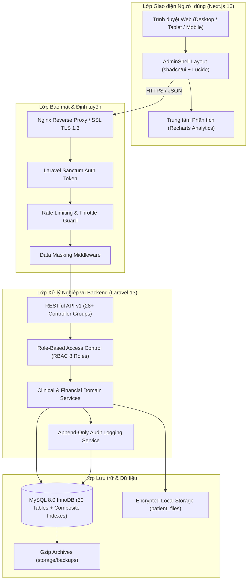

# SỔ TAY VẬN HÀNH HỆ THỐNG QUẢN LÝ PHÒNG KHÁM (QLPK) — GIAI ĐOẠN 3
## SYSTEM OPERATIONAL & ADMINISTRATION GUIDE (`PHASE-03`)
### Hệ thống Quản trị Toàn diện Phòng khám Đa khoa: Lâm sàng, Bệnh án Điện tử, Kho dược, Tài chính, Báo cáo & Khôi phục Thảm họa

- **Mã tài liệu:** `SOP-OPS-QLPK-03`
- **Phiên bản:** `3.0.0`
- **Ngày ban hành:** `2026-10-29`
- **Phân hệ áp dụng:** Toàn bộ hệ thống Backend (`Laravel 13`), Frontend (`Next.js 16 App Router`), Cơ sở dữ liệu (`MySQL 8.0`) và Kịch bản tự động hóa (`scripts/`).
- **Đối tượng sử dụng:** Ban Giám đốc Phòng khám, Trưởng khoa Lâm sàng, Bác sĩ điều trị, Điều dưỡng/Lễ tân, Dược sĩ, Thu ngân/Kế toán, Kỹ sư Vận hành Hệ thống (DevOps/SysAdmin).

---

## 1. TỔNG QUAN KIẾN TRÚC HỆ THỐNG & CÔNG NGHỆ

Hệ thống Quản lý Phòng khám Đa khoa (`QLPK`) vận hành theo mô hình kiến trúc phân tầng hiện đại (Decoupled Architecture), bảo đảm an toàn dữ liệu y tế, tính sẵn sàng cao và khả năng mở rộng linh hoạt:



### 1.1. Chi tiết Ngăn xếp Công nghệ (Technology Stack)
- **Backend Core:** PHP `^8.3`, Laravel Framework `^13.17`, ORM Eloquent với các chỉ mục phức hợp (Composite Indexes).
- **Frontend Core:** Next.js `16.4.2` (React `19.3.0`, App Router, Server/Client Components, TypeScript `5`).
- **Giao diện & Thành phần UI:** Tailwind CSS `v4`, bộ UI nguyên tử `shadcn/ui`, Icon vector chuẩn y tế `lucide-react`, Thư viện biểu đồ phân tích `recharts`.
- **Cơ sở dữ liệu:** MySQL `8.0` InnoDB (Bộ mã hóa `utf8mb4_unicode_ci`, 30 bảng quan hệ, khóa ngoại Cascade an toàn, chỉ mục tối ưu N+1 Query).
- **Xác thực & Bảo mật:** Laravel Sanctum Token Bearer, Role-Based Access Control (8 vai trò: `ADMIN`, `DIRECTOR`, `DOCTOR`, `NURSE`, `PHARMACIST`, `RECEPTIONIST`, `CASHIER`, `ACCOUNTANT`).
- **Lưu trữ Tệp y tế:** Phân vùng cách ly `storage/app/patient_files/{patient_id}/`, API phát trực tuyến nội tuyến (Inline Stream) có phân quyền.

---

## 2. QUY TRÌNH VẬN HÀNH NGHIỆP VỤ LÂM SÀNG & TÀI CHÍNH

### 2.1. Vòng đời Bệnh nhân Toàn trình (End-to-End Patient Journey)

```mermaid
flowchart LR
    A["1. Đặt lịch khám<br/>(Appointment)"] -->|Tiếp đón 1-Click| B["2. Check-in nguyên tử<br/>(Visit WAITING)"]
    B -->|Bác sĩ gọi khám| C["3. Khám lâm sàng<br/>(Visit IN_PROGRESS)"]
    C -->|Chụp X-quang / Xét nghiệm| D["4. Đính kèm Tệp y tế<br/>(patient_files)"]
    D -->|Chẩn đoán & Kê đơn| E["5. Bệnh án điện tử<br/>(MedicalRecord)"]
    E -->|Trừ tồn kho dược| F["6. Xuất kho thuốc<br/>(Inventory OUT)"]
    F -->|Sinh hóa đơn| G["7. Viện phí & Hóa đơn<br/>(Invoice UNPAID)"]
    G -->|Tạm ứng / Thu tiền| H["8. Thu ngân thanh toán<br/>(Payments & Sổ quỹ)"]
    H -->|Hoàn tất lượt khám| I["9. Kết thúc khám<br/>(Visit COMPLETED)"]
```



### 2.2. Hướng dẫn Thao tác tại từng Phân hệ

#### 1. Lễ tân & Đặt lịch khám (`/appointments`, `/visits`)
- **Tạo lịch hẹn:** Nhập số điện thoại, chọn bệnh nhân hoặc thêm nhanh; chọn chuyên khoa, bác sĩ khám và giờ khám.
- **Tiếp đón & Check-in nguyên tử:**
  - Bấm nút **"Tiếp nhận"** trên hàng lịch hẹn.
  - Hệ thống tự động kích hoạt `DB::transaction()` khóa bi quan (`lockForUpdate()`), chuyển trạng thái Lịch hẹn sang `COMPLETED`, sinh Lượt khám (`Visit`) mới ở trạng thái `WAITING` và cấp số thứ tự phòng khám.
  - Cơ chế chống click đúp ngăn chặn tuyệt đối việc tạo 2 lượt khám trùng lặp cho một lịch hẹn.
- **Tiếp đón bệnh nhân vãng lai (Walk-in):** Sử dụng nút **"Tiếp đón nhanh"** tại màn hình `/visits`, tìm kiếm bệnh nhân theo SĐT/CCCD và chỉ định phòng khám trực tiếp.

#### 2. Màn hình Khám bệnh & Bệnh án Điện tử (`/visits/[id]/medical-record`)
- **Chuyển trạng thái lượt khám:** Khi bác sĩ bắt đầu khám, lượt khám chuyển sang `IN_PROGRESS`.
- **Nhập liệu Bệnh án điện tử (Medical Record):**
  - **Triệu chứng lâm sàng & Tiền sử:** Lý do khám, huyết áp, nhịp tim, nhiệt độ, tiền sử dị ứng thuốc.
  - **Chẩn đoán y khoa:** Chẩn đoán sơ bộ, mã bệnh ICD-10 và chẩn đoán xác định.
  - **Chỉ định & Đơn thuốc:** Chọn thuốc từ danh mục kho, nhập liều dùng, số lượng, cách dùng.
  - **Hẹn tái khám:** Thiết lập trường `follow_up_date` để nhắc lịch tự động.
- **Lưu bệnh án:** Hệ thống tự động cập nhật trạng thái lượt khám sang `COMPLETED` và khóa chỉnh sửa thông thường.
- **Chỉnh sửa bệnh án sau hoàn thành (Audit Trail):**
  - Bác sĩ có quyền `medical_records.update` bắt buộc phải nhập **Lý do chỉnh sửa**.
  - Toàn bộ nội dung trước và sau khi sửa được tự động lưu vào `audit_logs` để bảo đảm tính pháp lý y khoa.

#### 3. Quản lý Tệp Đính kèm Y tế (`patient_files`)
- **Tải lên an toàn:** Hỗ trợ các định dạng X-quang, MRI, kết quả xét nghiệm PDF (`.jpg`, `.jpeg`, `.png`, `.pdf`) dung lượng tối đa 10MB/tệp.
- **Xem trước trực tiếp (Preview):** Bấm biểu tượng con mắt để xem trước tệp trực tiếp trong ứng dụng mà không để lộ đường dẫn tệp thực tế trên máy chủ.
- **Phân quyền truy cập:** Chỉ bác sĩ và nhân sự y tế được phân quyền `patient_files.view` mới có thể mở stream xem tệp. Mọi hành vi xem hoặc tải tệp đều ghi nhật ký kiểm toán.

#### 4. Quản lý Kho Dược & Vật tư Y tế (`/inventory`)
- **Kiểm soát xuất tồn kho:** Khi bác sĩ kê đơn hoặc xuất thuốc cho bệnh nhân, hệ thống thực hiện trừ tồn kho nguyên tử, tự động khóa bi quan dòng sản phẩm nhằm ngăn chặn tình trạng âm kho trong các khung giờ cao điểm.
- **Cảnh báo tồn kho thấp (`LOW_STOCK`):** Hệ thống tự động đánh dấu cờ cảnh báo khi tồn kho thực tế giảm xuống dưới ngưỡng an toàn tối thiểu (`min_stock`).

#### 5. Thu ngân, Thanh toán Đa đợt, Công nợ & Sổ quỹ (`/invoices`, `/debts`, `/cash-book`)
- **Lập hóa đơn tự động:** Kết hợp tiền khám dịch vụ và tiền thuốc từ đơn của bác sĩ, hỗ trợ áp dụng chiết khấu/giảm giá.
- **Thanh toán nhiều đợt (Partial Payment):**
  - Hỗ trợ thanh toán tạm ứng (Đợt 1) và tất toán (Đợt 2) bằng các phương thức: Tiền mặt (`CASH`), Chuyển khoản ngân hàng (`BANK_TRANSFER`), Thẻ POS (`CARD`).
  - Hệ thống kiểm tra nghiêm ngặt: số tiền thanh toán không được vượt quá số dư nợ còn lại của hóa đơn (`remaining_amount`).
- **Tự động ghi Sổ quỹ:** Mỗi giao dịch thanh toán thành công sẽ tự động sinh một bản ghi `CashTransaction` loại `IN` trong sổ quỹ tiền tệ tương ứng với phương thức thanh toán.
- **Quản lý Tuổi nợ (Debt Aging):** Phân tích các khoản công nợ chưa tất toán theo các dải thời gian: 0-7 ngày, 8-30 ngày và trên 30 ngày để bộ phận kế toán có kế hoạch thu hồi nợ.

#### 6. Trung tâm Báo cáo Quản trị Đa chiều (`/reports`, `/dashboard`, `/kpi`)
- **Biểu đồ Donut (Donut Chart):** Phân tích cơ cấu tỷ trọng doanh thu theo từng phương thức thanh toán và danh mục chi phí vận hành.
- **Biểu đồ Cột (Bar Chart):** So sánh thực đạt doanh thu và số ca khám của từng bác sĩ với chỉ tiêu KPI được giao trong tháng.
- **Biểu đồ Vùng (Area Chart):** Phân tích xu hướng biến động doanh thu thuần và lưu lượng bệnh nhân theo chuỗi thời gian 12 tháng qua.

---

## 3. QUY TRÌNH BẢO MẬT & PHÂN QUYỀN VẬN HÀNH

### 3.1. Ma trận Phân quyền 8 Vai trò (RBAC Matrix)

| Vai trò | Mã Vai trò | Quyền Quản trị | Khám & Bệnh án | Kho Dược | Hóa đơn & Sổ quỹ | Báo cáo Quản trị |
|---|---|:---:|:---:|:---:|:---:|:---:|
| **Quản trị viên Hệ thống** | `ADMIN` | Toàn quyền | Xem / Audit | Quản trị | Toàn quyền | Toàn quyền |
| **Ban Giám đốc** | `DIRECTOR` | Phê duyệt | Xem | Xem | Phê duyệt chi | Toàn quyền |
| **Bác sĩ Điều trị** | `DOCTOR` | Không | Khám / Kê đơn / Sửa có lý do | Xem tồn kho | Xem | Báo cáo cá nhân |
| **Điều dưỡng / Y tá** | `NURSE` | Không | Tiếp đón / Đính kèm tệp | Xem | Xem | Không |
| **Dược sĩ Quản lý Kho** | `PHARMACIST` | Không | Không | Nhập / Xuất / Kiểm kê | Không | Báo cáo tồn kho |
| **Nhân viên Lễ tân** | `RECEPTIONIST` | Không | Đặt lịch / Tiếp đón nhanh | Không | Xem | Thống kê tiếp đón |
| **Nhân viên Thu ngân** | `CASHIER` | Không | Không | Không | Lập hóa đơn / Thu tiền | Sổ quỹ ca trực |
| **Kế toán Trưởng** | `ACCOUNTANT` | Không | Không | Đối soát kho | Toàn quyền sổ quỹ / Nợ | Toàn quyền Tài chính |

### 3.2. Che giấu Dữ liệu Nhạy cảm (Data Masking)
- Các tài khoản không có quyền quản trị viên cao cấp sẽ tự động bị ẩn các ký tự giữa của Số điện thoại (ví dụ: `0912***456`) và Căn cước công dân (`079******123`) trên API và Giao diện để bảo đảm quyền riêng tư của bệnh nhân theo Luật Khám bệnh, chữa bệnh.

### 3.3. Giới hạn Tần suất Truy cập (Rate Limiting)
- API Đăng nhập (`/api/v1/auth/login`): Tối đa 5 lần thử trong 1 phút để chống brute-force mật khẩu.
- API Tải tệp y tế (`/api/v1/patient-files`): Tối đa 30 yêu cầu/phút.
- API Xuất báo cáo CSV (`/api/v1/exports`): Tối đa 10 yêu cầu/phút nhằm bảo vệ tài nguyên máy chủ.

---

## 4. QUY TRÌNH SAO LƯU & PHỤC HỒI THẢM HỌA (DISASTER RECOVERY)

### 4.1. Kịch bản Sao lưu Tự động (`scripts/backup-db.sh`)
- **Tập lệnh:** [`scripts/backup-db.sh`](file:///Users/truongthinh/Documents/UIT/Manage%20Infomation/clinic-management-system/scripts/backup-db.sh)
- **Cơ chế:** Đọc thông tin kết nối từ file `.env` một cách an toàn, xuất cấu trúc và dữ liệu 30 bảng MySQL sang file SQL nén `.sql.gz` có gắn nhãn thời gian, lưu tại `storage/backups/`.
- **Chính sách lưu trữ (Retention Policy):** Tự động dọn dẹp các tệp sao lưu cũ hơn 30 ngày để tiết kiệm dung lượng đĩa cứng.
- **Cấu hình Cron Job hàng ngày (02:00 AM):**
```bash
# Mở crontab của người dùng triển khai
crontab -e

# Bổ sung dòng cấu hình sao lưu hàng ngày lúc 2 giờ sáng
0 2 * * * /bin/bash /Users/truongthinh/Documents/UIT/Manage\ Infomation/clinic-management-system/scripts/backup-db.sh >> /Users/truongthinh/Documents/UIT/Manage\ Infomation/clinic-management-system/storage/logs/backup.log 2>&1
```

### 4.2. Kịch bản Khôi phục CSDL An toàn (`scripts/restore-db.sh`)
- **Tập lệnh:** [`scripts/restore-db.sh`](file:///Users/truongthinh/Documents/UIT/Manage%20Infomation/clinic-management-system/scripts/restore-db.sh)
- **Nguyên tắc an toàn tối cao:**
  1. Tuyệt đối không bao giờ tự động ghi đè cơ sở dữ liệu chính khi chưa có người vận hành xác nhận rõ ràng.
  2. Bắt buộc chạy kiểm thử tính toàn vẹn (Dry-run mode) trước khi khôi phục chính thức:
```bash
# Kiểm tra trợ giúp
bash scripts/restore-db.sh --help

# Chế độ kiểm tra tính toàn vẹn (Dry-run) trên database tạm
bash scripts/restore-db.sh --dry-run storage/backups/qlpk_backup_YYYYMMDD_HHMMSS.sql.gz

# Khôi phục chính thức (yêu cầu xác nhận "YES")
bash scripts/restore-db.sh storage/backups/qlpk_backup_YYYYMMDD_HHMMSS.sql.gz
```
- Chi tiết các bước ứng phó sự cố được quy định tại [`docs/phase-3/DISASTER_RECOVERY_RUNBOOK.md`](file:///Users/truongthinh/Documents/UIT/Manage%20Infomation/clinic-management-system/docs/phase-3/DISASTER_RECOVERY_RUNBOOK.md).

---

## 5. TỐI ƯU HIỆU NĂNG & BẢO TRÌ ĐỊNH KỲ

### 5.1. Chỉ mục Phức hợp (Composite Indexes)
Cơ sở dữ liệu đã được bổ sung các Composite Indexes chiến lược cho các bảng giao dịch lớn:
- `visits`: `(patient_id, status)`, `(employee_id, visit_date)`
- `appointments`: `(patient_id, appointment_date)`, `(status, appointment_date)`
- `invoices`: `(patient_id, status)`, `(invoice_date, status)`
- `cash_transactions`: `(payment_method, transaction_type, transaction_date)`
- `inventory_transactions`: `(product_id, transaction_type, transaction_date)`
- `audit_logs`: `(user_id, created_at)`, `(module, action)`

### 5.2. Lệnh Kiểm tra Sức khỏe Hệ thống Định kỳ
Trước mỗi ca trực hoặc sau mỗi kỳ bảo trì, kỹ sư vận hành thực hiện kiểm tra theo checklist sau:

1. **Kiểm tra Suite Test Backend:**
```bash
cd be && php artisan test
```
*Yêu cầu:* 100% test suites đạt trạng thái `PASS` (Bao gồm `EndToEndPhase3WorkflowTest`).

2. **Kiểm tra Định dạng Chuẩn Mã nguồn:**
```bash
cd be && ./vendor/bin/pint --test
```
*Yêu cầu:* Tất cả file PHP tuân thủ tiêu chuẩn PSR-12 và Laravel Code Style.

3. **Kiểm tra Biên dịch & Typecheck Frontend:**
```bash
cd fe && npm run build
```
*Yêu cầu:* 0 lỗi Type checking TypeScript, 0 lỗi cú pháp Tailwind CSS v4, tối ưu hóa các trang SSG/SSR.

4. **Kiểm tra Quyền hạn Thư mục Lưu trữ:**
```bash
chmod -R 775 be/storage be/bootstrap/cache
chmod +x scripts/*.sh
```

---

## 6. DANH MỤC LIÊN KẾT TÀI LIỆU HỆ THỐNG LIÊN QUAN

- Báo cáo Tổng kết Hoàn thành Giai đoạn 3: [`docs/phase-3/PHASE_3_REPORT.md`](file:///Users/truongthinh/Documents/UIT/Manage%20Infomation/clinic-management-system/docs/phase-3/PHASE_3_REPORT.md)
- Báo cáo Nghiệm thu Chuẩn hóa UI/UX: [`docs/phase-3/UI_STANDARDIZATION_REPORT.md`](file:///Users/truongthinh/Documents/UIT/Manage%20Infomation/clinic-management-system/docs/phase-3/UI_STANDARDIZATION_REPORT.md)
- Sổ tay Khôi phục Thảm họa (DR Runbook): [`docs/phase-3/DISASTER_RECOVERY_RUNBOOK.md`](file:///Users/truongthinh/Documents/UIT/Manage%20Infomation/clinic-management-system/docs/phase-3/DISASTER_RECOVERY_RUNBOOK.md)
- Báo cáo Audit Kỹ thuật Toàn bộ Hệ thống: [`docs/phase-3/PHASE_3_AUDIT_REPORT.md`](file:///Users/truongthinh/Documents/UIT/Manage%20Infomation/clinic-management-system/docs/phase-3/PHASE_3_AUDIT_REPORT.md)
- Thiết kế Cơ sở Dữ liệu 30 Bảng Chuẩn: [`docs/phase-1/DATABASE_DESIGN.md`](file:///Users/truongthinh/Documents/UIT/Manage%20Infomation/clinic-management-system/docs/phase-1/DATABASE_DESIGN.md)

---
*Tài liệu được phê duyệt và lưu hành nội bộ bởi Ban Quản trị Dự án QLPK — 2026.*
