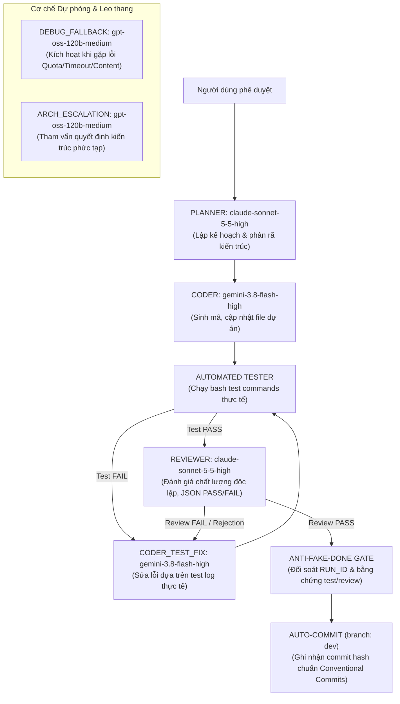
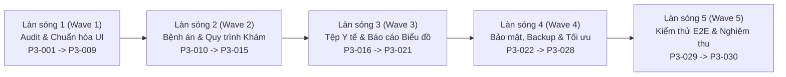

# KẾ HOẠCH TRIỂN KHAI CHI TIẾT GIAI ĐOẠN 3 (`PHASE_3_IMPLEMENTATION_PLAN.md`)
## Lộ trình Thực thi Tuần tự, Định tuyến Đa Mô hình, Cổng Kiểm định Chất lượng & Cây Phụ thuộc (DAG)

- **Mã tài liệu:** `docs/phase-3/PHASE_3_IMPLEMENTATION_PLAN.md`
- **Phiên bản:** `1.0.0`
- **Giai đoạn:** `PHASE-03`
- **Chiến lược thực thi:** Chia thành 5 Làn sóng (Waves) kế tiếp nhau, tuân thủ nguyên tắc "Zero Breaking Change" trên cơ sở dữ liệu thực tế và cây Git.
- **Quy tắc an toàn tối thượng:**
  1. Tuyệt đối không xóa bảng hoặc chạy lệnh phá hủy (`migrate:fresh`, `db:wipe`).
  2. Tuyệt đối không commit hoặc merge trực tiếp lên branch `main`. Mọi công việc chạy trên branch `dev`.
  3. Mọi task chỉ được công nhận `DONE` khi vượt qua cả 2 cổng: Cổng Kiểm thử Tự động (`OVERALL_TEST_RESULT: PASS`) và Cổng Reviewer Độc lập (`OVERALL_REVIEW_RESULT: PASS`).

---

## 1. CHIẾN LƯỢC ĐỊNH TUYẾN ĐA MÔ HÌNH (MULTI-MODEL ROUTING STRATEGY)

Để khắc phục triệt để sự cố cạn kiệt hạn ngạch (quota exhaustion) của mô hình `gemini-4-argon-high`, hệ thống áp dụng cấu hình định tuyến thông minh giữa Claude, GPT và Gemini Flash:



### Bảng phân công vai trò mô hình trong Phase 3:
| Vai trò trong Framework | Model ID cấu hình | Lý do lựa chọn | Phương án dự phòng (Fallback) |
|---|---|---|---|
| **Planner** | `claude-sonnet-5-5-high` | Khả năng lập luận logic sắc bén, quy hoạch kiến trúc toàn diện | `gpt-oss-120b-medium` |
| **Coder** | `gemini-3.8-flash-high` | Tốc độ sinh mã cực nhanh, hạn ngạch token lớn, hỗ trợ tool edit chuẩn xác | `claude-sonnet-5-5-high` |
| **Reviewer** | `claude-sonnet-5-5-high` | Tiêu chuẩn đánh giá nghiêm ngặt, phát hiện lỗ hổng logic & fake DONE | `gpt-oss-120b-medium` |
| **Debug Fallback** | `gpt-oss-120b-medium` | Giải quyết các bài toán gỡ lỗi hóc búa khi model chính gặp lỗi quota | `gemini-3.8-flash-high` |
| **Arch Escalation**| `gpt-oss-120b-medium` | Tham vấn cấu trúc dữ liệu và giải quyết xung đột nghiệp vụ | `claude-opus-5-5-medium` |

---

## 2. LỘ TRÌNH THỰC THI 5 LÀN SÓNG (5-WAVE ROLLOUT ROADMAP)



### Làn sóng 1 (Wave 1): Khảo sát & Chuẩn hóa UI/UX Toàn Diện (`P3-001` → `P3-009`)
- **Mục tiêu:** Giải quyết triệt để vấn đề "nhức nhối" nhất của hệ thống hiện tại: bảng dữ liệu bị dồn cột, chữ xuống hàng 2-3 dòng, form thiếu loading/validation, modal vỡ bố cục.
- **Các tasks:**
  - `P3-001` → `P3-003`: Khảo sát toàn diện mã nguồn, CSDL 30 bảng MySQL và hoàn tất bộ tài liệu hoạch định Phase 3.
  - `P3-004`: Chuẩn hóa bảng dữ liệu toàn hệ thống (`overflow-x-auto`, `whitespace-nowrap`, không dồn cột).
  - `P3-005`: Chuẩn hóa toàn bộ Form nhập liệu (dấu sao bắt buộc, inline error, loading spinner, chống gửi lặp).
  - `P3-006`: Chuẩn hóa cấu trúc các trang danh sách (List Page Pattern 8 khối).
  - `P3-007`: Chuẩn hóa Dialog xác nhận thao tác nguy hiểm và Modal nghiệp vụ.
  - `P3-008`: Tối ưu Responsive đa thiết bị (Desktop, Tablet, Mobile) và khả năng truy cập (A11y).
  - `P3-009`: Rà soát và lập biên bản kiểm tra giao diện trước - sau chuẩn hóa tại `docs/phase-3/UI_STANDARDIZATION_REPORT.md`.

### Làn sóng 2 (Wave 2): Hồ sơ Bệnh nhân, Bệnh án Điện tử & Lịch khám (`P3-010` → `P3-015`)
- **Mục tiêu:** Hoàn thiện trải nghiệm khám bệnh cốt lõi cho Bác sĩ và Tiếp đón Lễ tân.
- **Các tasks:**
  - `P3-010`: Nâng cấp Hồ sơ bệnh nhân & Xây dựng Trục thời gian lịch sử khám (Clinical Timeline).
  - `P3-011`: Hoàn thiện màn hình và nghiệp vụ Bệnh án điện tử (Khám chuyên môn, phác đồ, tái khám).
  - `P3-012`: Phân quyền bảo mật bệnh án và xây dựng cơ chế Audit Trail lưu vết lịch sử chỉnh sửa y khoa.
  - `P3-013`: Chuẩn hóa máy trạng thái Lịch hẹn và bộ lọc đa tiêu chí.
  - `P3-014`: Hoàn thiện luồng Tiếp đón nhanh tại quầy lễ tân (tìm kiếm nhanh SĐT/CCCD, xếp hàng).
  - `P3-015`: Chuyển đổi nguyên tử từ Lịch hẹn sang Lượt khám chống tạo trùng.

### Làn sóng 3 (Wave 3): Quản lý Tệp Y tế & Trung tâm Báo cáo Trực quan (`P3-016` → `P3-021`)
- **Mục tiêu:** Kích hoạt tính năng quản lý tệp đính kèm y tế (`patient_files`) và trực quan hóa dữ liệu quản trị.
- **Các tasks:**
  - `P3-016`: Xây dựng Backend API tải lên tệp đính kèm y tế có kiểm tra định dạng và chống virus/mã độc.
  - `P3-017`: Xây dựng Backend API phát trực tuyến (stream) tải xuống và xem trước tệp có xác thực.
  - `P3-018`: Xây dựng giao diện kéo thả, tải lên và xem trước ảnh X-quang/kết quả xét nghiệm trên Frontend.
  - `P3-019`: Chuẩn hóa biểu đồ tròn/Donut Chart thể hiện cơ cấu doanh thu, phương thức thanh toán, chi phí.
  - `P3-020`: Chuẩn hóa biểu đồ cột/Bar Chart so sánh hiệu suất bác sĩ và chỉ tiêu KPI phòng khám.
  - `P3-021`: Chuẩn hóa biểu đồ vùng/Area Chart thể hiện xu hướng tăng trưởng doanh thu và lượt khám 12 tháng.

### Làn sóng 4 (Wave 4): Nâng cao Bảo mật, Sao lưu & Tối ưu Hiệu năng (`P3-022` → `P3-028`)
- **Mục tiêu:** Củng cố hàng rào an ninh dữ liệu y tế, chuẩn bị quy trình phục hồi thảm họa và tối ưu tốc độ truy vấn.
- **Các tasks:**
  - `P3-022`: Hoàn thiện ma trận phân quyền RBAC chuyên sâu cho hồ sơ y tế và tệp đính kèm.
  - `P3-023`: Nâng cấp hệ thống Audit Log ghi nhận mọi hành vi xem/tải dữ liệu nhạy cảm.
  - `P3-024`: Che dấu dữ liệu cá nhân nhạy cảm (Data Masking) và thiết lập cơ chế giới hạn tần suất (Rate Limiting).
  - `P3-025`: Xây dựng kịch bản tự động sao lưu cơ sở dữ liệu `scripts/backup-db.sh` kèm nén gzip.
  - `P3-026`: Xây dựng kịch bản khôi phục CSDL `scripts/restore-db.sh` và sổ tay vận hành `DISASTER_RECOVERY_RUNBOOK.md`.
  - `P3-027`: Bổ sung các Composite Indexes chiến lược trên MySQL cho các bảng giao dịch lớn.
  - `P3-028`: Tối ưu hóa truy vấn Eloquent, triệt tiêu N+1 Query và tối ưu phân trang.

### Làn sóng 5 (Wave 5): Kiểm thử Tích hợp Toàn diện & Nghiệm thu Bàn giao (`P3-029` → `P3-030`)
- **Mục tiêu:** Đảm bảo toàn bộ hệ thống hoạt động gắn kết, ổn định và sẵn sàng đưa vào vận hành thực tế.
- **Các tasks:**
  - `P3-029`: Xây dựng bộ test suite E2E tự động bao phủ trọn vẹn luồng Tiếp nhận -> Khám -> Đơn thuốc -> Thanh toán -> Sổ quỹ.
  - `P3-030`: Nghiệm thu toàn diện hệ thống, biên soạn Báo cáo hoàn thành `PHASE_3_REPORT.md` và Sổ tay Vận hành `OPERATIONAL_GUIDE.md`.

---

## 3. ĐỒ THỊ PHỤ THUỘC TÁC VỤ (DEPENDENCY GRAPH - DAG)

```text
P3-001 (Audit Backend & DB)
  └─> P3-002 (Audit Frontend & Tests)
        └─> P3-003 (Audit Planning Gate) [GATE NGƯỜI DÙNG PHÊ DUYỆT]
              │
              ├─> P3-004 (Bảng dữ liệu không dồn cột)
              │     └─> P3-005 (Form & Validation)
              │           └─> P3-006 (List Page Pattern)
              │                 └─> P3-007 (Dialog & Confirmation)
              │                       └─> P3-008 (Responsive & A11y)
              │                             └─> P3-009 (Báo cáo UI/UX)
              │
              └─> P3-010 (Timeline Bệnh nhân)
                    └─> P3-011 (Bệnh án Điện tử)
                          └─> P3-012 (Audit Trail Bệnh án)
                                └─> P3-013 (Trạng thái Lịch hẹn)
                                      └─> P3-014 (Tiếp đón Lễ tân)
                                            └─> P3-015 (Check-in Nguyên tử)
                                                  │
                                                  ├─> P3-016 (API Upload Tệp)
                                                  │     └─> P3-017 (API Download Tệp)
                                                  │           └─> P3-018 (UI Tệp Y tế)
                                                  │
                                                  ├─> P3-019 (Biểu đồ Donut)
                                                  │     └─> P3-020 (Biểu đồ Bar)
                                                  │           └─> P3-021 (Biểu đồ Line/Area)
                                                  │
                                                  └─> P3-022 (Phân quyền RBAC Y tế)
                                                        └─> P3-023 (Audit Log Nhạy cảm)
                                                              └─> P3-024 (Data Masking & Rate Limit)
                                                                    │
                                                                    ├─> P3-025 (Script Backup DB)
                                                                    │     └─> P3-026 (Script Restore DB & Runbook)
                                                                    │
                                                                    └─> P3-027 (Composite Indexes)
                                                                          └─> P3-028 (Tối ưu Eloquent & N+1)
                                                                                │
                                                                                └─> P3-029 (E2E Integration Test)
                                                                                      └─> P3-030 (Tổng nghiệm thu & Bàn giao)
```

---

## 4. CỔNG KIỂM ĐỊNH CHẤT LƯỢNG (QUALITY GATES)

Mỗi task trong suốt 30 tasks bắt buộc phải vượt qua các cổng kiểm định chất lượng sau trước khi được phép ghi nhận trạng thái `DONE`:

1. **Gate 1 — Cú pháp & Kiểu dữ liệu (Syntax & Typing Gate):**
   - Backend: `php -l` và `vendor/bin/pint --test` không có lỗi cú pháp hoặc định dạng mã.
   - Frontend: `npm run build` không có lỗi TypeScript hoặc lỗi JSX biên dịch.
2. **Gate 2 — Kiểm thử Tự động Chức năng (Automated Test Gate):**
   - Lệnh kiểm thử đặc thù của từng task trong `test_commands` phải trả về mã thoát `0` (`exit code = 0`).
   - Không được làm suy giảm số lượng test hiện có của hệ thống (tối thiểu 285 tests PHPUnit tiếp tục PASS).
3. **Gate 3 — Review Độc lập Chống Fake DONE (Anti-Fake-DONE Review Gate):**
   - Mô hình Reviewer (`claude-sonnet-5-5-high`) thực hiện phân tích mã nguồn độc lập.
   - Bắt buộc kiểm tra khớp `RUN_ID` phiên làm việc, không chấp nhận kết quả cũ hoặc báo cáo giả định.
   - Trả về JSON chứa `"verdict": "PASS"` có kèm phân tích bằng chứng cụ thể.
4. **Gate 4 — Git Clean Tree Gate:**
   - Cây thư mục Git sạch sẽ trước và sau khi thực hiện task, tự động commit lên branch `dev` kèm commit message rõ ràng theo chuẩn Conventional Commits.
